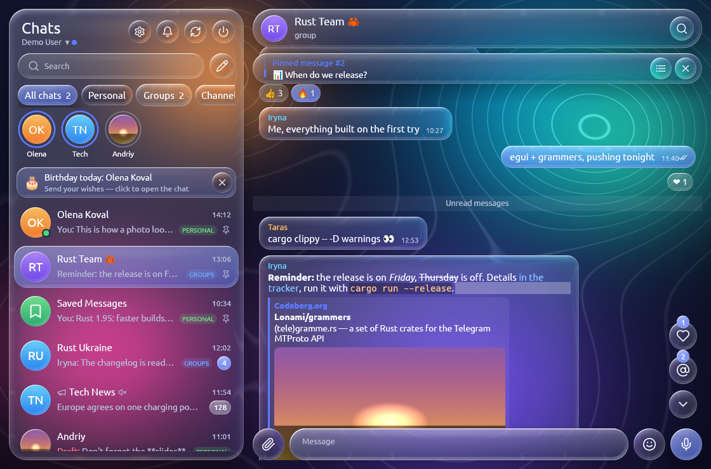
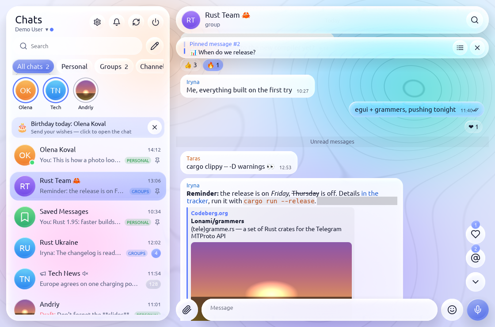

# Glassgram

**English** · [Українська](README.uk.md)

A desktop Telegram client in Rust with a **Liquid Glass** style interface.

<!-- progress -->
**Roadmap progress: 71%** `██████████████░░░░░░` — 119 done, 22 partial, 41 to go ([ROADMAP.md](ROADMAP.md))
<!-- /progress -->

<p>
  
  
</p>

[](https://ko-fi.com/K8Z3299QVD)

- **MTProto**: [grammers](https://codeberg.org/Lonami/grammers): sign-in by phone number or QR code, 2FA, chats, history, replies, editing and deleting, live updates
- **Media**: avatars, photos, stickers with a disk cache (`~/.local/share/glassgram/cache`); sending files and stickers; voice and audio with a waveform, seeking and speed, a music player bar with the chat's music as its queue (repeat, shuffle, playlist) and profile music; GIFs, round videos and webm stickers right in the chat, a video player with full screen and picture-in-picture that streams large videos instead of downloading them first; voice recording (needs ffmpeg with `ffplay`)
- **Chats**: forums with topics, channel comments, folders and archive, pinning, muting, drafts, "online" and "typing…" statuses
- **Search**: global (the field above the chat list, with Chats, Channels, Apps, Posts and Media tabs) and in-chat (🔍 in the header)
- **Formatting**: Telegram entities are shown, markup is converted when sending
- **Messages**: forwarding, multi-select, silent and scheduled sending, bot buttons, pasting from the clipboard, file progress
- **Notifications**: system ones on Linux, Windows and macOS with "Reply" and "Mark as read" buttons (Linux, Windows), sounds with the account's ringtones and a chat's own sound, a counter in the window title, a tray icon
- **Languages**: Ukrainian and English built into the code (always offline), every language Telegram Desktop offers (Settings → Language lists them with native names, "beta" and how much is translated; a click downloads the pack, caches it and switches at once, no restart), plus localisation files (`locales/*.json`, see below)
- **Accounts**: several accounts, switched in the menu under the name in the header (`src/accounts.rs`)
- **Settings** (⚙): language, theme (dark, light, system), interface scale, notifications, autoplay, SOCKS5 and MTProto proxies (several, switched on the fly, with ping), privacy, active sessions, local passcode; stored in `~/.local/share/glassgram/settings`
- **Settings layout** as in Telegram Desktop: My Account (name, bio, username with availability check and its QR code, profile photo, name and profile colour with a live preview, emoji status) · My Stories (stories saved to the profile, albums and the archive) · Notifications · Privacy and Security · Chat Settings · Folders · Advanced · Devices · Language · My Stars (balance and history with All / Incoming / Outgoing tabs; a click on a transaction shows its details)
- **Send queue**: text messages, files, voice and round video messages show up at once (clock), are retried while offline and survive a restart; failed ones get a red mark with Retry / Delete
- **Glass**: real blur via a wgpu shader (`src/blur.rs`, `src/glass.wgsl`); without wgpu — a vector fallback
- **UI**: egui / eframe (wgpu), our own glass renderer — `src/glass.rs`

## Installing

Ready builds are on the [Releases](https://github.com/petro-pixel/glassgram/releases) page; they already
contain the Telegram API keys and ffmpeg, so you only sign in with your phone number:
- **Windows**: `Glassgram-<version>-setup.exe`;
- **Linux**: `Glassgram.flatpak` — `flatpak install --user Glassgram.flatpak`, then `flatpak run io.github.petro_pixel.Glassgram`.

### Code signing policy

Free code signing provided by [SignPath.io](https://about.signpath.io/), certificate by [SignPath Foundation](https://signpath.org/).
The Windows installer and `glassgram.exe` are built and signed by GitHub Actions (`.github/workflows/release.yml`)
from this repository; the bundled `ffmpeg.exe` is the upstream build and is not signed by us.

- Committers and reviewers: [petro-pixel](https://github.com/petro-pixel)
- Approvers: [petro-pixel](https://github.com/petro-pixel)

Privacy: this program will not transfer any information to other networked systems unless specifically
requested by the user or the person installing or operating it. It connects only to the Telegram servers to run
your account, and opens bot mini apps and links only when you do.

## Running from source

```sh
cargo run --release -- --demo   # demo with made-up chats (in English), no network
cargo run --release             # real account
```

On Linux the build needs WebKitGTK for mini app windows: `sudo apt install libwebkit2gtk-4.1-dev pkg-config`
(`sudo dnf install webkit2gtk4.1-devel` on Fedora, `sudo pacman -S webkit2gtk-4.1` on Arch); the version from the distribution's repositories is used. Windows (WebView2) and macOS (WKWebView) need nothing extra.

A build from source needs an `api_id` and `api_hash` from <https://my.telegram.org> → *API development tools*.
Enter them in the sign-in window or pass them via the `TG_API_ID` / `TG_API_HASH` variables. To build them
into the binary as the releases do, set `GLASSGRAM_API_ID` / `GLASSGRAM_API_HASH` while building (`build.rs`); add `--features no-key-screen`
to drop the key screen as well (without a connection the app offers "Retry" instead).

The session and credentials are stored in the data folder: `~/.local/share/glassgram/` on Linux,
`%APPDATA%\glassgram\` on Windows, `~/Library/Application Support/glassgram/` on macOS.

Voice, audio, video and recording need ffmpeg (`ffmpeg` and `ffplay`):
- **Linux**: from the distribution (`sudo apt install ffmpeg`, `sudo dnf install ffmpeg`…);
- **Windows**: put `ffmpeg.exe` and `ffplay.exe` next to `glassgram.exe` or anywhere in `PATH`;
- **macOS**: `brew install ffmpeg`.

On Linux the microphone is taken from PipeWire (`pw-record`) when it runs, otherwise from PulseAudio;
`GLASSGRAM_AUDIO=pulse` or `GLASSGRAM_AUDIO=pipewire` forces one. On Windows closing the window hides
Glassgram to the tray; quit from the tray icon's menu.

Windows and macOS builds compile but haven't been tried on real machines yet.

## Translations

Ukrainian and English live in the code. Every other language is a JSON file keyed by the English string:

```json
{ "@name": "Deutsch", "Cancel": "Abbrechen", "{n} votes": { "one": "{n} Stimme", "other": "{n} Stimmen" } }
```

1. Copy [locales/template.json](locales/template.json) (all strings, empty values) to `<code>.json`, e.g. `pl.json`.
2. Set `@name` and translate the values; keep `{placeholders}` as they are. Empty values fall back to English.
   Counted strings (`{"one": "", "other": ""}`) take the [CLDR plural forms](https://www.unicode.org/cldr/charts/latest/supplemental/language_plural_rules.html)
   your language uses: `zero`, `one`, `two`, `few`, `many`, `other`.
3. Put the file into the `locales` folder next to the session and settings (`~/.local/share/glassgram/locales/`)
   and pick the language in Settings → Language. No rebuild needed.
4. To ship it with the app, add it to `locales/` and to `BUILTIN` in `src/i18n.rs`.

Languages from Telegram's list come from translations.telegram.org: their packs are keyed by Telegram Desktop keys, and
[locales/tdesktop-keys.json](locales/tdesktop-keys.json) maps our English strings to those keys (only exact meaning matches;
`{"key", "args"}` renames placeholders; plural keys like `lng_xxx#few` are picked by the language's CLDR rule). A string is looked up in a localisation file first, then in the Telegram pack, then shown in English.

## Structure

| File | What it does |
|---|---|
| `src/backend.rs` | Tokio thread: the `Cmd` / `Ev` protocol with the UI, the `Worker` (connection, dialogs, history) dispatching commands to feature handlers |
| `src/backend/types.rs` | Data handed to the UI: chats, messages, media, folders, privacy, presence |
| `src/backend/loader.rs`, `src/backend/convert.rs` | Background image downloads with a disk cache; Telegram objects → our types (tests on recorded server replies in `convert/tests.rs`) |
| `src/backend/updates.rs`, `src/backend/upload.rs` | Live updates and QR login loops; sending files, downloads, media cache |
| `src/backend/login.rs`, `src/backend/sessions.rs` | Signing in (code, 2FA, QR) and out; active sessions |
| `src/backend/sending.rs`, `src/backend/scheduled.rs`, `src/backend/inline.rs` | Sending, editing, deleting, reactions, votes; scheduled messages; inline bots and buttons |
| `src/backend/dialogs.rs`, `src/backend/folders.rs`, `src/backend/topics.rs`, `src/backend/comments.rs` | Chat list actions, folders, forum topics, channel comments |
| `src/backend/account.rs`, `src/backend/outbox.rs` | Own profile, username and photo; one send attempt from the queue (text, or files uploaded in the background) |
| `src/cache.rs` | Local cache of dialogs, messages and the send queue (SQLite via `libsql`) |
| `src/blur.rs`, `src/blur/content.rs`, `src/glass.wgsl` | GPU blur: background into a texture → Gaussian → glass panels: a clear refracting rim with dispersion and a light-facing glint over a frosted, slightly magnifying middle; the chat content under the header and composer is tessellated again (text as soft pills, pictures from thumbnails) over a copy of the background and blurred for the bars |
| `src/glass.rs` | Live background, glass panels (gradient, specular rim, refraction halo, shadow), buttons, fields, avatars, glass behind egui menus and tooltips, accessibility modes |
| `src/glass/palette.rs` | Telegram's peer colours: the 7 built-in name colours, the server's extra and profile colours, multi-tone stripes |
| `src/app.rs` | `App`: state, events (`push_event`), user actions (`apply`), the frame loop |
| `src/app/history.rs`, `src/app/bubbles.rs` | The open chat: history, header, overlays; drawing bubbles, albums, media cards, reactions |
| `src/app/composer.rs`, `src/app/recording.rs` | The message field: text, files, stickers, emoji, inline bots; voice and round video recording |
| `src/app/media.rs`, `src/app/dialogs.rs` | Audio player, video clips, photo viewer; export, forward, schedule boxes |
| `src/app/videoplayer.rs` | Video player: seek bar, volume, speed, full screen, picture-in-picture |
| `src/backend/stream.rs` | Streaming large videos: a local HTTP server (127.0.0.1) serving byte ranges fetched from Telegram on demand |
| `src/app/login.rs`, `src/app/accounts_ui.rs` | Sign-in screens and the passcode lock; the account menu and the other accounts in the background |
| `src/app/forum.rs`, `src/app/comments.rs`, `src/app/folders.rs` | Forum topics, channel comments, folder editor with tag colours, folder tags on chat rows, recommended folders |
| `src/app/chatview.rs`, `src/backend/chatview.rs` | Chat view extras: pinned bar and list, jump buttons (down / mentions / reactions), "Seen by", view counters, protected content |
| `src/app/chatedit.rs`, `src/backend/chatedit.rs` | "Edit group / channel": photo, title, description, member permissions, slow mode, allowed reactions, hidden members, anti-spam |
| `src/app/birthdays.rs`, `src/backend/birthdays.rs` | Birthdays: reminder above the chat list, birthday in user info and in My Account |
| `src/app/botstart.rs`, `src/backend/botstart.rs` | Bot deep links `t.me/<bot>?start=…`: Start bar with the parameter |
| `src/app/attachbots.rs`, `src/backend/attachbots.rs` | Attachment menu bots: the list in the 📎 menu, adding from `t.me/<bot>?startattach`, removing |
| `src/app/urlauth.rs`, `src/backend/urlauth.rs` | Logging in to websites with Telegram: "Log in" buttons and links (`requestUrlAuth`) |
| `src/app/similar.rs`, `src/backend/similar.rs` | "Similar channels" tab in a channel's info |
| `src/app/music.rs`, `src/backend/music.rs` | Music player bar and playlist: the chat's music as the queue (`messages.search`), repeat, shuffle; a user's profile music (`users.getSavedMusic`) |
| `src/app/sendas.rs`, `src/backend/sendas.rs` | Sending as a channel: the avatar button left of the field and its menu (`channels.getSendAs`, `messages.saveDefaultSendAs`) |
| `src/app/saved.rs`, `src/backend/saved.rs` | Saved Messages split by source: "All" and one tab per chat; reaction tags as filters, renaming them |
| `src/app/chatsearch.rs` | In-chat search panel: type and sender filters, results |
| `src/app/searchtabs.rs`, `src/backend/searchtabs.rs` | Global search tabs: channels, apps (popular mini app bots), public posts, media |
| `src/app/stories.rs`, `src/backend/stories.rs` | Stories: strip above the chat list and the viewer (video with sound, replies, reactions) |
| `src/app/story_post.rs`, `src/backend/story_post.rs` | Posting a story: "+" in the strip, the box with preview, caption, privacy, duration, profile and channel choice |
| `src/app/profile_stories.rs`, `src/backend/profile_stories.rs` | Stories in profiles: the pinned grid with album chips in chat info, Settings → My Stories with the archive, views and the viewers list of our own stories (read only) |
| `src/app/confirm.rs` | "Open this link?" for hidden links and "Run this file?" for received programs |
| `src/app/gifts.rs`, `src/backend/gifts.rs` | "Gifts" tab in a profile |
| `src/app/stars.rs`, `src/backend/stars.rs` | Settings → My Stars: balance and transaction history (read only) |
| `src/app/textures.rs` | Pictures on the GPU with a memory budget; dropped ones come back from the disk cache |
| `src/app/emojikw.rs`, `src/backend/emojikw.rs` | Emoji suggestions while typing `:word` |
| `src/app/custom_emoji.rs`, `src/backend/custom_emoji.rs` | Custom emoji in message text: pictures drawn over the fallback emoji |
| `src/app/effects.rs`, `src/backend/effects.rs` | Message effects: the emoji badge by the time, the animation played over the chat, the effects row in the send menu |
| `src/app/viewonce.rs`, `src/backend/viewonce.rs` | View-once and timed photos and videos: the cover, opening once, "expired" afterwards; sending view once |
| `src/app/namecolor.rs`, `src/backend/namecolor.rs` | Name colours of authors and reply stripes, emoji status after names; name colour, profile colour and emoji status pickers in My Account |
| `src/app/report.rs`, `src/backend/report.rs` | "Report" box for messages |
| `src/app/quote.rs`, `src/backend/reply.rs` | Replies with a quote and in another chat |
| `src/app/newchat.rs`, `src/backend/newchat.rs` | "New chat": contacts, new group, new channel with its type, link and subscribers |
| `src/app/privacy.rs`, `src/backend/privacy.rs` | Privacy rule exceptions (always / never allow) and global switches: new non-contact chats, read time, who can message me; sensitive content filtering |
| `src/app/password.rs`, `src/backend/password.rs` | Two-step verification: turning the cloud password on and off, changing it, its hint and recovery email (SRP, the code sent to the email) |
| `src/app/polls.rs`, `src/backend/polls.rs` | Polls: the card, the "New poll" box (polls and quizzes), voters per answer, adding answers |
| `src/app/todo.rs`, `src/backend/todo.rs` | Checklists: the card, ticking and adding items, the "New checklist" box |
| `src/errlog.rs` | Error log file, panic hook, report for the developer |
| `src/app/selfdestruct.rs`, `src/backend/selfdestruct.rs` | "Delete my account if away for…" |
| `src/app/dice.rs`, `src/backend/dice.rs` | Emoji games (🎲 🎯 🏀 ⚽ 🎰 🎳): sending and outcomes |
| `src/app/storage.rs`, `src/backend/storage.rs` | "Data and storage": cache usage by type, clearing, size limit |
| `src/app/adminlog.rs`, `src/backend/adminlog.rs` | "Recent actions" admin log; author signatures and the discussion group of a channel |
| `src/app/manage.rs`, `src/backend/manage.rs` | "Manage" box: administrators and their rights and titles, restricted and removed members |
| `src/app/invites.rs`, `src/backend/invites.rs` | Invite links (name, expiry, limit, approval; revoke, delete) and join requests |
| `src/app/chatlists.rs`, `src/backend/chatlists.rs` | Shared folders by link: adding, new chats, leaving |
| `src/app/stickers.rs`, `src/backend/stickers.rs` | The sticker panel, the sticker set box, set search and order, favourite stickers, saved GIFs |
| `src/app/autodl.rs` | Automatic media download by chat type and video size; photos held back in `backend/media.rs` |
| `src/app/autodelete.rs`, `src/backend/autodelete.rs` | Auto-delete timers: the default for new chats, a chat's own |
| `src/app/wallpapers.rs`, `src/backend/wallpapers.rs`, `src/wallpaper.rs` | Chat backgrounds and themes: the gallery, a picture from a file, a chat's own wallpaper and theme; fills and patterns drawn on the CPU |
| `src/app/langpack.rs`, `src/backend/langpack.rs` | Settings → Language: Telegram's language list, downloading and caching packs (`langpacks/`), refreshing them with `getDifference`, live switching |
| `src/app/websites.rs`, `src/backend/websites.rs` | "Logged in with Telegram": connected websites, disconnecting them |
| `src/app/calls.rs`, `src/backend/calls.rs` | The "Calls" box (call log) and call cards in history |
| `src/app/editmedia.rs`, `src/backend/editmedia.rs` | Editing media messages: caption, replacing the photo or file |
| `src/app/richtext.rs` | Formatting bar over selected text in the composer, formatting shortcuts |
| `src/app/sendbox.rs`, `src/app/spoiler.rs`, `src/zip.rs` | "Send files" box (previews, caption, compression, spoiler, caption above, folders and "one archive" packed into zip); spoiler cover over hidden media |
| `src/app/webapp.rs`, `src/backend/webapp.rs`, `src/webview.rs` | Mini apps: server requests, the WebView window process (`glassgram --webview`) and its bridge |
| `src/app/contacts.rs`, `src/backend/contacts.rs` | "New contact" box, add / delete contact and block from user info, blocked list in Privacy and Security |
| `src/app/translate.rs`, `src/backend/translate.rs` | "Translate" window from the message menu; whole-chat translation: the translate bar under the header, batched `messages.translateText`, `messages.togglePeerTranslations` (`translate/detect.rs` guesses a chat's language) |
| `src/app/aitext.rs`, `src/backend/aitext.rs` | Voice and round video transcription ("→A", live `updateTranscribedAudio`), AI summaries of long posts |
| `src/app/factcheck.rs`, `src/backend/factcheck.rs` | Fact checks under messages (`getFactCheck` for shown `need_check` messages, folding), member tags by author names |
| `src/app/calendar.rs` | "Jump to date" calendar over the chat (the request is `Cmd::JumpToDate` in `src/backend/chatview.rs`) |
| `src/app/notify.rs`, `src/backend/notify.rs` | Notifications for chats: private / groups / channels defaults, exceptions, resolving a chat's mute state from its category |
| `src/app/alerts.rs` | Message notifications: "Reply" and "Mark as read" buttons, a click opens the chat, one notification per chat with a counter (Linux) |
| `src/app/proxy.rs`, `src/backend/proxy.rs` | Proxies: the saved list with pings, switching without a restart, `t.me/proxy` links; a local SOCKS5 bridge for grammers that forwards straight, via SOCKS5 or in MTProxy's obfuscated transport |
| `src/app/sounds.rs`, `src/backend/sounds.rs` | Notification sounds: the built-in chime, saved ringtones (list, add, delete, cached files), a chat's own sound, reaction notification settings |
| `src/app/sponsored.rs`, `src/backend/sponsored.rs` | Sponsored messages in channel history (after the newest post and between posts, media ads): "Ad" bubble, view and click reports, "About this ad", reporting, hiding for Premium |
| `src/app/suggest.rs`, `src/backend/suggest.rs` | Link previews (in bubbles and above the composer), @mention and bot command suggestions, "Start" for bots |
| `src/app/info.rs`, `src/backend/info.rs` | Chat info column: profile, members, shared media, per-chat notifications, leave / clear / delete |
| `src/app/settings_pages.rs` | Settings pages (Telegram Desktop layout), My Account editor |
| `src/app/photoedit.rs`, `src/app/photoedit/render.rs` | Photo editor in the "Send files" box: crop with aspect presets, rotate, flip, drawing, text in three styles and fonts; rendered on a thread (`vello_cpu`) into a temporary file |
| `src/app/userqr.rs`, `src/draw.rs` | QR code of a public username in six designs, drawn on the CPU (`vello_cpu`): copy, save as PNG |
| `src/app/layout.rs` | Window layout modes: narrow (one column), normal, wide (chat info as a third column) |
| `src/app/motion.rs` | Spring animations (Apple-style, 150–350 ms): new bubbles, the folder tab capsule and list slide, column transitions; "Reduce motion" snaps them |
| `src/app/hotkeys.rs` | Keyboard shortcuts |
| `src/app/outbox.rs` | Send queue: pending/failed bubbles, retries with backoff |
| `src/app/chatlist.rs` | Folder column and tabs, dragging pinned chats and folders |
| `src/player.rs` | Voice, audio and video sound via `ffplay`: pause, seeking, speed, volume |
| `src/video.rs` | Video frames via `ffmpeg` into an egui texture: GIFs, round videos, videos, webm stickers; `.tgs` stickers from `src/lottie.rs` |
| `src/lottie.rs` | Animated (Lottie) stickers drawn on the CPU: `velato` + `vello_cpu`, with limits for untrusted files |
| `src/camera.rs` | Video message recording: camera + microphone → MP4, round preview; the microphone for all recordings (`Mic`) |
| `src/recorder.rs` | Voice recording via `ffmpeg`, level and waveform |
| `src/export.rs` | Chat history export to HTML and JSON |
| `src/platform.rs` | Everything that differs between Linux, Windows and macOS: folders, ffmpeg/ffplay, notifications; the safe openers for links (`open_url`) and received files (`open_file`, `safe_file_name`), private temp files |
| `src/settings.rs` | Settings and saving them |
| `src/lock.rs` | Local passcode (salt + SHA-256) |
| `src/tray.rs`, `src/logo.rs`, `src/badge.rs` | Tray icon (`ksni` on Linux, `tray-icon` on Windows and macOS), the app logo, and the unread badge on the taskbar or dock icon |
| `src/icons.rs`, `assets/icons/` | Vector icons: Lucide SVG files (24×24), parsed with `roxmltree` and flattened with `kurbo` |
| `src/i18n.rs`, `src/i18n/plural.rs`, `locales/` | UI language: `l!`/`lf!`/`lp!` (counted, CLDR plural rules) for Ukrainian and English, JSON localisation files and Telegram packs (via `tdesktop-keys.json`) for the rest |
| `src/format.rs` | Telegram entities ↔ markup, formatted text for egui, fonts (Ubuntu, Noto Color Emoji) |
| `src/emoji.rs`, `assets/emoji.txt`, `src/app/emojipanel.rs` | Emoji 17.0: the panel list by category (generated from Unicode's `emoji-test.txt`), skin tones, the emoji tab and big-emoji messages |
| `src/demo.rs`, `src/demo/` | Demo data |
| `build.rs` | Telegram API keys from the build environment (masked), the Windows exe icon |
| `packaging/`, `.github/workflows/release.yml` | Windows installer (Inno Setup), Flatpak manifest, `.desktop`, metainfo, icons; release builds |
| `.github/workflows/ci.yml` | Build and tests on Linux, Windows and macOS for every push and pull request |

## Controls

- Right-click a message for the menu: reply, copy, edit, delete.
- Double-click — reply. Click the reply bar above the field to quote a part of the message or to reply in another chat.
- Esc cancels a reply or edit and closes the sticker panel.
- 📎 — send files (or drag them into the window, or paste them): a box shows what goes, with the caption (the composer text), "Compress images", "Hide with spoiler", "Caption above media" and (one photo or video in a private chat) "View once"; more files dropped on it join it. A dropped folder goes as a zip archive; with several items, "Send as one archive" packs them all into one. Right click on 📎: send without compression, create a poll or quiz, create a checklist, and the attachment menu bots allowed in this chat (a click opens the bot's mini app for the chat, a right click removes it from the menu); a `t.me/<bot>?startattach` link asks to add its bot there first. A "Log in" button under a bot message (or a link to a site that supports it) asks "Log in to <domain> as <name>?", optionally letting the bot message you; "Don't log in" opens the plain address. A click on a checklist item ticks it; "View results" under a public poll lists who voted for what; a poll's menu retracts your vote or stops your own poll. A photo or video under a spoiler opens with a click. A view-once or timed photo or video shows a cover: a click opens it once, then it expires. Editing a photo or file ("Edit" in its menu): ⟳ in the "Editing" bar replaces it (right click — without compression), or drop a file on the chat.
- 🙂 — sticker panel: emoji (right click or a long press on 👋 and other people picks the skin tone, remembered for that emoji), GIF (saved GIFs), 🔍 (search sticker sets; empty — trending), ★ favourite and 🕒 recent stickers, then the installed sets; ⚙ — your sets: order (↑/↓) and removing. Right click on a sticker: add to / remove from favourites, view its set. A click on a sticker in a chat (or a `t.me/addstickers/…` link) opens its set: all stickers, "Add" / "Remove", copy link; right click on a sticker in a chat — "View sticker set", "Add to Favourites", on a GIF — "Save GIF". An emoji typed alone offers matching stickers above the field.
- Click a photo or file — download it to Downloads and open it.
- Right-click a chat: pin, mute, mark as read, archive.
- A wide window shows chat info as a third column beside the chat; a narrow one shows the chat list or the open chat alone, with a back arrow in the chat header (Esc also returns to the list).
- Click the chat title in the header to open chat info (Esc closes it): bio/description, links, notifications, members (click opens a private chat; admins right-click a member to promote, restrict or remove them), shared media tabs, a "Stories" tab with a person's or channel's pinned stories (album chips filter them; a click opens the viewer at that story), leave / clear history / delete chat. Admins open invite links, join requests, administrators, restricted and removed users from the "Edit" box (pencil) or, without the right to edit, from the people icon in the header.
- "+" on your avatar at the head of the story strip (or "Add story" in Settings → My Stories) picks a photo or video for a new story: the box previews it and sets the caption, who can see it, how long it stays, screenshots, keeping it on the profile and posting as a channel.
- Composer markup: `**bold**`, `__italic__`, `~~strike~~`, `||spoiler||`, `` `code` ``, ```` ```block``` ````, `[text](https://…)`; the field shows it styled with the markers faded. Selecting text shows a formatting bar above it; shortcuts: Ctrl+B bold, Ctrl+I italic, Ctrl+Shift+X strikethrough, Ctrl+Shift+M monospace, Ctrl+Shift+P spoiler, Ctrl+K link, Ctrl+Shift+N clear formatting.
- Clicking a hashtag searches for it in the chat; clicking a bot command sends it.
- `@` in a group and `/` at the start of the composer open suggestions (members, bot commands): ↑/↓ — select, Enter or click — insert (a command is sent), Tab — insert, Esc — close. The "/" button next to the composer in a bot chat opens the command menu. `:word` (two letters or more, e.g. `:heart`, `:серце`) suggests emoji the same way.
- A link preview appears above the composer; ✕ sends the message without it.
- Right-click "Send": in a private chat, a row of message effects on top (★ — Premium) sends the message with that effect; then send silently, schedule, or (in a private chat whose last seen time is visible) send when online. A message with an effect plays it when it first appears; a click on the effect's emoji by the time plays it again.
- In a group or channel that lets you post as a channel you run, a round avatar left of 📎 shows who messages go as; a click lists your account and those channels (Premium-only ones are marked) and picks the default for that chat.
- A chat in another language (where Telegram allows it) shows "Translate to …" under the header: a click shows its messages translated in place, marked "translated" by the time (Telegram Premium), "Show original" switches back. ⚙ on the bar picks the language, "Don't translate …" stops offering that language, "Hide the bar" hides it for the chat; "Translate chat" in the chat's menu in the list brings it back.
- "Select" in the message menu turns on selection mode; Esc leaves it.
- A message of just 🎲 🎯 🏀 ⚽ 🎰 or 🎳 is sent as a game.
- A `t.me/addlist/…` link adds a shared folder; its right-click menu checks for new chats, and deleting it offers to leave its chats.
- Settings → Chat Settings → Chat background: the server gallery (pictures, patterns, colours and gradients), a picture from a file, or the live background; a private chat's info → "Chat wallpaper and theme" sets that chat's own wallpaper and emoji or gift theme.
- Settings → Chat Settings → Accessibility: reduce transparency (solid glass), increase contrast, reduce motion (a still background).
- Settings → Advanced → "Automatic media download" picks what loads on its own in private chats, groups and channels; other media show an arrow and load on a click.
- Enter sends, Shift+Enter — new line.
- Jump to a date: the calendar button in chat search, or click a date chip between messages.
- Enter sends, Shift+Enter starts a new line; Settings → Chat Settings switches sending to Ctrl+Enter (Cmd+Enter on macOS) and sets the message text size and the chat list density (compact, standard, large).
- Hotkeys (as in Telegram Desktop): Ctrl+F — search in the chat (or the chat list), Ctrl+K — chat list search, Ctrl+1…9 — folders, Alt+↑/↓ or Ctrl+Tab / Ctrl+Shift+Tab — previous/next chat, Ctrl+E or ↑ in an empty composer — edit your last message, Esc — close the topmost panel, then the chat.
- In `--demo`, a message containing `#offline` pretends there is no network (clock → retries → red mark).
- Folders: "+" to the right of the tabs (or at the bottom of the column) — new; right-click a folder — edit or delete; dragging changes the order. Tabs on top or a column on the left — in Settings.
- Pinned chats can be dragged to change their order (in folders and in the archive too).
- ✎ next to search — "New group", "New channel", "Contacts", "Calls" (the call log; right-click to delete).
- Typing in the chat list search shows tabs under it: Chats, Channels, Apps, Posts, Media. Posts are searched with Enter or the "Search posts" button (free searches a day are limited); Esc clears the search and returns to Chats.
- Ctrl+V with an image or copied files sends them.
- ▶ on a voice or audio message plays it; clicking the waveform seeks, the "1×" chip changes the speed. Clicking a video opens the player: the seek bar, volume, speed (0.5–2×), full screen and picture-in-picture (a small window in a corner that keeps playing while you browse chats; drag it to another corner). Keys: Space — play/pause, ←/→ — 5 s back/forward, F — full screen, Esc — leave full screen, then close. "Open in player" (the system one) is in the menu.
- "→A" by a voice message's waveform (beside a round video) transcribes it (Telegram Premium; without it the server's few free tries): a spinner while the server works, then the text under the waveform; a second click folds it.
- A long channel post shows a "Summary" capsule above its text: a click puts the AI summary in its place, "Show original" in its header brings the text back.
- Playing a music file shows the player bar under the chat header: ⏮ / ⏭ — previous / next track (⏮ after 3 s restarts the track), the line along its bottom seeks, then volume, speed, repeat (playlist → track → off), shuffle and ✕ to close. The bar stays while you switch chats; the next track of the chat starts on its own. Clicking the title opens the playlist. A user's profile music is a row in their info: a click plays it.
- The pencil on a photo in the "Send files" box opens the photo editor: "Crop" (drag the corners or edges, move the frame; rotate left, flip, aspect presets), "Draw" (colour, brush size, undo), "Text" (click the photo to add text, drag it to move; style, font, colour and size). Ctrl+Z — undo, Enter — done, Esc — cancel. The edited photo replaces the original in the box; the pencil again continues the same edit.
- 🎤 (the "Send" button when the composer is empty) starts voice recording; ➤ sends, ■ stops for review, Esc cancels.
- Right-click the microphone — record a video message (camera — in Settings or `GLASSGRAM_CAMERA`).

## What's done and what's next

The full roadmap with priorities and time estimates is in [ROADMAP.md](ROADMAP.md).
Rules for agents and the design code are in [AGENTS.md](AGENTS.md).

## License

GPL-3.0-or-later, like Telegram Desktop. See [LICENSE](LICENSE).
The Ubuntu font is under the Ubuntu Font Licence, see [assets/fonts/UFL.txt](assets/fonts/UFL.txt).
Colour emoji are [Noto Color Emoji](https://github.com/googlefonts/noto-emoji) under the SIL Open Font License 1.1, see [assets/fonts/OFL-NotoColorEmoji.txt](assets/fonts/OFL-NotoColorEmoji.txt).
Icons are from [Lucide](https://lucide.dev) under the ISC licence, see [assets/icons/LUCIDE-LICENSE.txt](assets/icons/LUCIDE-LICENSE.txt).
Glassgram is an unofficial client and is not affiliated with Telegram FZ-LLC.
