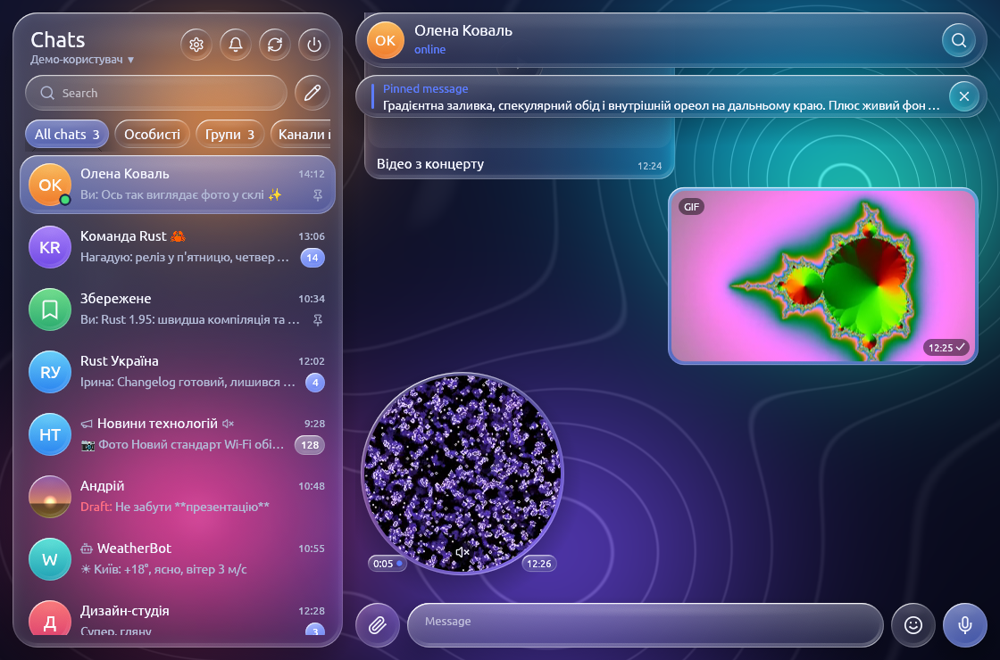
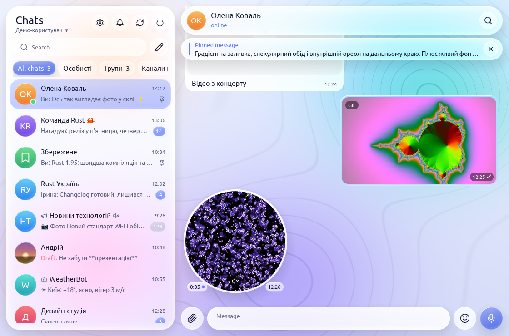

# Glassgram

**English** · [Українська](README.uk.md)

A desktop Telegram client in Rust with a **Liquid Glass** style interface.

<!-- progress -->
**Roadmap progress: 40%** `████████░░░░░░░░░░░░` — 59 done, 13 partial, 90 to go ([ROADMAP.md](ROADMAP.md))
<!-- /progress -->

<p>
  
  
</p>

[](https://ko-fi.com/K8Z3299QVD)

- **MTProto**: [grammers](https://codeberg.org/Lonami/grammers): sign-in by phone number or QR code, 2FA, chats, history, replies, editing and deleting, live updates
- **Media**: avatars, photos, stickers with a disk cache (`~/.local/share/glassgram/cache`); sending files and stickers; voice and audio with a waveform, seeking and speed; videos, GIFs, round videos and webm stickers right in the chat; voice recording (needs ffmpeg with `ffplay`)
- **Chats**: forums with topics, channel comments, folders and archive, pinning, muting, drafts, "online" and "typing…" statuses
- **Search**: global (the field above the chat list) and in-chat (🔍 in the header)
- **Formatting**: Telegram entities are shown, markup is converted when sending
- **Messages**: forwarding, multi-select, silent and scheduled sending, bot buttons, pasting from the clipboard, file progress
- **Notifications**: system ones on Linux, Windows and macOS, a counter in the window title, a tray icon
- **Languages**: Ukrainian and English built into the code, German and any other language from localisation files (`locales/*.json`, see below)
- **Accounts**: several accounts, switched in the menu under the name in the header (`src/accounts.rs`)
- **Settings** (⚙): language, theme (dark, light, system), interface scale, notifications, autoplay, SOCKS5 proxy, privacy, active sessions, local passcode; stored in `~/.local/share/glassgram/settings`
- **Settings layout** as in Telegram Desktop: My Account (name, bio, username with availability check, profile photo) · Notifications · Privacy and Security · Chat Settings · Folders · Advanced · Devices · Language
- **Send queue**: text messages show up at once (clock), are retried while offline and survive a restart; failed ones get a red mark with Retry / Delete
- **Glass**: real blur via a wgpu shader (`src/blur.rs`, `src/glass.wgsl`); without wgpu — a vector fallback
- **UI**: egui / eframe (wgpu), our own glass renderer — `src/glass.rs`

## Installing

> [!WARNING]
> There is no ready binary of the current code. The latest release (v0.3.0) is out of date: it has none of the
> features added since — sponsored messages, notifications for chats, jump to date, translation, contacts, mini apps.
> Run the project with cargo: `cargo run --release` (see [Running from source](#running-from-source)).

Ready builds are on the [Releases](https://github.com/petro-pixel/glassgram/releases) page; they already
contain the Telegram API keys and ffmpeg, so you only sign in with your phone number:
- **Windows**: `Glassgram-<version>-setup.exe`;
- **Linux**: `Glassgram.flatpak` — `flatpak install --user Glassgram.flatpak`, then `flatpak run io.github.petro_pixel.Glassgram`.

## Running from source

```sh
cargo run --release -- --demo   # demo with made-up chats, no network
cargo run --release             # real account
```

On Linux the build needs WebKitGTK for mini app windows: `sudo apt install libwebkit2gtk-4.1-dev pkg-config`
(`sudo dnf install webkit2gtk4.1-devel` on Fedora, `sudo pacman -S webkit2gtk-4.1` on Arch); the version from the distribution's repositories is used. Windows (WebView2) and macOS (WKWebView) need nothing extra.

A build from source needs an `api_id` and `api_hash` from <https://my.telegram.org> → *API development tools*.
Enter them in the sign-in window or pass them via the `TG_API_ID` / `TG_API_HASH` variables. To build them
into the binary as the releases do, set `GLASSGRAM_API_ID` / `GLASSGRAM_API_HASH` while building (`build.rs`).

The session and credentials are stored in the data folder: `~/.local/share/glassgram/` on Linux,
`%APPDATA%\glassgram\` on Windows, `~/Library/Application Support/glassgram/` on macOS.

Voice, audio, video and recording need ffmpeg (`ffmpeg` and `ffplay`):
- **Linux**: from the distribution (`sudo apt install ffmpeg`, `sudo dnf install ffmpeg`…);
- **Windows**: put `ffmpeg.exe` and `ffplay.exe` next to `glassgram.exe` or anywhere in `PATH`;
- **macOS**: `brew install ffmpeg`.

On Linux the microphone is taken from PipeWire (`pw-record`) when it runs, otherwise from PulseAudio;
`GLASSGRAM_AUDIO=pulse` or `GLASSGRAM_AUDIO=pipewire` forces one. On Windows closing the window hides
Glassgram to the tray; quit from the tray icon's menu.

Windows and macOS builds compile but haven't been tried on real machines yet.

## Translations

Ukrainian and English live in the code. Every other language is a JSON file keyed by the English string:

```json
{ "@name": "Deutsch", "Cancel": "Abbrechen", "Votes: {n}": "Stimmen: {n}" }
```

1. Copy [locales/template.json](locales/template.json) (all strings, empty values) to `<code>.json`, e.g. `pl.json`.
2. Set `@name` and translate the values; keep `{placeholders}` as they are. Empty values fall back to English.
3. Put the file into the `locales` folder next to the session and settings (`~/.local/share/glassgram/locales/`)
   and pick the language in Settings → Language. No rebuild needed.
4. To ship it with the app, add it to `locales/` and to `BUILTIN` in `src/i18n.rs`.

## Structure

| File | What it does |
|---|---|
| `src/backend.rs` | Tokio thread: login, dialogs, history, updates; `Cmd` / `Ev` channels to the UI |
| `src/backend/account.rs`, `src/backend/outbox.rs` | Own profile, username and photo; one send attempt from the queue |
| `src/cache.rs` | Local cache of dialogs, messages and the send queue (SQLite via `libsql`) |
| `src/blur.rs`, `src/glass.wgsl` | GPU blur: background into a texture → Gaussian → glass panels with refraction |
| `src/glass.rs` | Live background, glass panels (gradient, specular rim, refraction halo, shadow), buttons, fields, avatars |
| `src/app.rs` | Sign-in and chat screens |
| `src/app/chatview.rs`, `src/backend/chatview.rs` | Chat view extras: pinned bar and list, jump buttons (down / mentions / reactions), "Seen by", view counters, protected content |
| `src/app/chatedit.rs`, `src/backend/chatedit.rs` | "Edit group / channel": photo, title, description, member permissions, slow mode |
| `src/app/privacy.rs`, `src/backend/privacy.rs` | Privacy rule exceptions (always / never allow) and global switches: new non-contact chats, read time, who can message me |
| `src/app/polls.rs`, `src/backend/polls.rs` | "New poll" box: polls and quizzes |
| `src/app/webapp.rs`, `src/backend/webapp.rs`, `src/webview.rs` | Mini apps: server requests, the WebView window process (`glassgram --webview`) and its bridge |
| `src/app/contacts.rs`, `src/backend/contacts.rs` | "New contact" box, add / delete contact and block from user info, blocked list in Privacy and Security |
| `src/app/translate.rs`, `src/backend/translate.rs` | "Translate" window from the message menu |
| `src/app/calendar.rs` | "Jump to date" calendar over the chat (the request is `Cmd::JumpToDate` in `src/backend/chatview.rs`) |
| `src/app/notify.rs`, `src/backend/notify.rs` | Notifications for chats: private / groups / channels defaults, exceptions, resolving a chat's mute state from its category |
| `src/app/sponsored.rs`, `src/backend/sponsored.rs` | Sponsored messages at the end of channel history: "Ad" bubble, view and click reports, "About this ad", reporting |
| `src/app/suggest.rs`, `src/backend/suggest.rs` | Link previews (in bubbles and above the composer), @mention and bot command suggestions, "Start" for bots |
| `src/app/info.rs`, `src/backend/info.rs` | Chat info column: profile, members, shared media, per-chat notifications, leave / clear / delete |
| `src/app/settings_pages.rs` | Settings pages (Telegram Desktop layout), My Account editor |
| `src/app/hotkeys.rs` | Keyboard shortcuts |
| `src/app/outbox.rs` | Send queue: pending/failed bubbles, retries with backoff |
| `src/app/chatlist.rs` | Folder column and tabs, dragging pinned chats and folders, "New chat" |
| `src/player.rs` | Voice and audio player via `ffplay`: pause, seeking, speed |
| `src/video.rs` | Video frames via `ffmpeg` into an egui texture: GIFs, round videos, videos, webm stickers |
| `src/camera.rs` | Video message recording: camera + microphone → MP4, round preview; the microphone for all recordings (`Mic`) |
| `src/recorder.rs` | Voice recording via `ffmpeg`, level and waveform |
| `src/export.rs` | Chat history export to HTML and JSON |
| `src/platform.rs` | Everything that differs between Linux, Windows and macOS: folders, opening files, ffmpeg/ffplay, notifications |
| `src/settings.rs` | Settings and saving them |
| `src/lock.rs` | Local passcode (salt + SHA-256) |
| `src/tray.rs`, `src/logo.rs` | Tray icon (`ksni` on Linux, `tray-icon` on Windows and macOS) and the app logo |
| `src/icons.rs`, `assets/icons/` | Vector icons: Lucide SVG files (24×24), parsed with `roxmltree` and flattened with `kurbo` |
| `src/i18n.rs`, `locales/` | UI language: `l!`/`lf!` for Ukrainian and English, JSON localisation files for the rest |
| `src/format.rs` | Telegram entities ↔ markup, formatted text for egui, fonts |
| `src/demo.rs` | Demo data |
| `build.rs` | Telegram API keys from the build environment (masked), the Windows exe icon |
| `packaging/`, `.github/workflows/release.yml` | Windows installer (Inno Setup), Flatpak manifest, `.desktop`, metainfo, icons; release builds |

## Controls

- Right-click a message for the menu: reply, copy, edit, delete.
- Double-click — reply.
- Esc cancels a reply or edit and closes the sticker panel.
- 📎 — send files (or drag them into the window); the composer text becomes the caption. Right click on 📎: send without compression, create a poll or quiz.
- 🙂 — sticker panel.
- Click a photo or file — download it to Downloads and open it.
- Right-click a chat: pin, mute, mark as read, archive.
- Click the chat title in the header to open chat info (Esc closes it): bio/description, links, notifications, members (click opens a private chat), shared media tabs, leave / clear history / delete chat.
- Composer markup: `**bold**`, `__italic__`, `~~strike~~`, `||spoiler||`, `` `code` ``, ```` ```block``` ````, `[text](https://…)`.
- Clicking a hashtag searches for it in the chat; clicking a bot command sends it.
- `@` in a group and `/` at the start of the composer open suggestions (members, bot commands): ↑/↓ — select, Enter or click — insert (a command is sent), Tab — insert, Esc — close. The "/" button next to the composer in a bot chat opens the command menu.
- A link preview appears above the composer; ✕ sends the message without it.
- Right-click "Send": send silently or schedule.
- "Select" in the message menu turns on selection mode; Esc leaves it.
- Enter sends, Shift+Enter — new line.
- Jump to a date: the calendar button in chat search, or click a date chip between messages.
- Enter sends, Shift+Enter starts a new line; Settings → Chat Settings switches sending to Ctrl+Enter (Cmd+Enter on macOS) and sets the message text size.
- Hotkeys (as in Telegram Desktop): Ctrl+F — search in the chat (or the chat list), Ctrl+K — chat list search, Ctrl+1…9 — folders, Alt+↑/↓ or Ctrl+Tab / Ctrl+Shift+Tab — previous/next chat, Ctrl+E or ↑ in an empty composer — edit your last message, Esc — close the topmost panel, then the chat.
- In `--demo`, a message containing `#offline` pretends there is no network (clock → retries → red mark).
- Folders: "+" to the right of the tabs (or at the bottom of the column) — new; right-click a folder — edit or delete; dragging changes the order. Tabs on top or a column on the left — in Settings.
- Pinned chats can be dragged to change their order (in folders and in the archive too).
- ✎ next to search — "New group", "New channel", "Contacts".
- Ctrl+V with an image or copied files sends them.
- ▶ on a voice or audio message plays it; clicking the waveform seeks, the "1×" chip changes the speed. Clicking a video plays it in the bubble; "Open in player" is in the menu.
- 🎤 (the "Send" button when the composer is empty) starts voice recording; ➤ sends, ■ stops for review, Esc cancels.
- Right-click the microphone — record a video message (camera — in Settings or `GLASSGRAM_CAMERA`).

## What's done and what's next

The full roadmap with priorities and time estimates is in [ROADMAP.md](ROADMAP.md).
Rules for agents and the design code are in [AGENTS.md](AGENTS.md).

## License

GPL-3.0-or-later, like Telegram Desktop. See [LICENSE](LICENSE).
The Ubuntu font is under the Ubuntu Font Licence, see [assets/fonts/UFL.txt](assets/fonts/UFL.txt).
Icons are from [Lucide](https://lucide.dev) under the ISC licence, see [assets/icons/LUCIDE-LICENSE.txt](assets/icons/LUCIDE-LICENSE.txt).
Glassgram is an unofficial client and is not affiliated with Telegram FZ-LLC.
