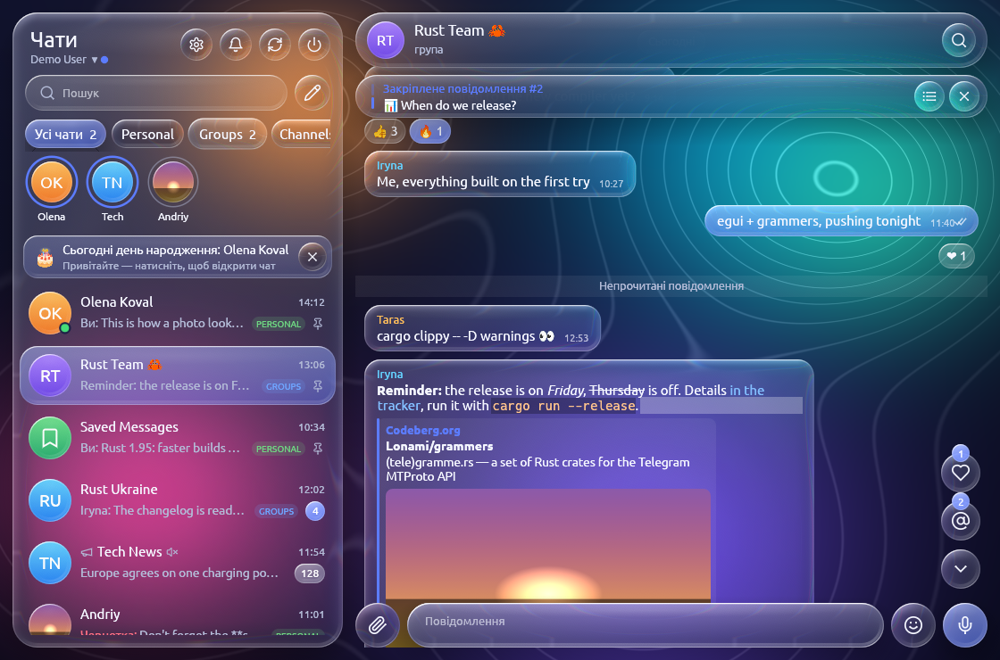
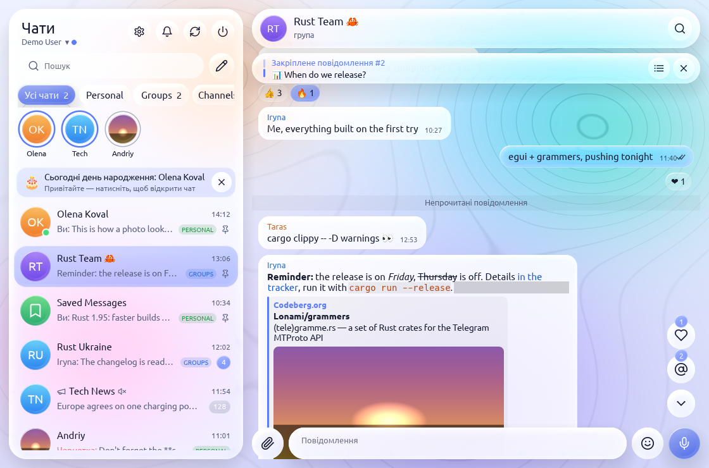

# Glassgram

[English](README.md) · **Українська**

Десктопний клієнт Telegram на Rust з інтерфейсом у стилі **Liquid Glass**.

<!-- progress -->
**Готовність за дорожньою картою: 70%** `██████████████░░░░░░` — 119 готово, 17 частково, 46 попереду ([ROADMAP.md](ROADMAP.md))
<!-- /progress -->

<p>
  
  
</p>

[](https://ko-fi.com/K8Z3299QVD)

- **MTProto**: [grammers](https://codeberg.org/Lonami/grammers): вхід за номером або QR-кодом, 2FA, чати, історія, відповіді, редагування й видалення, оновлення наживо
- **Медіа**: аватарки, фото, стікери з дисковим кешем (`~/.local/share/glassgram/cache`); надсилання файлів і стікерів; голосові та аудіо з хвильовою формою, перемотуванням і швидкістю, панель музичного плеєра з музикою чату як чергою (повтор, перемішування, плейлист) і музикою в профілі; GIF, кружечки й webm-стікери прямо в чаті, відеопрогравач із повним екраном і «картинкою в картинці», який грає великі відео потоком, не чекаючи повного завантаження; запис голосових (потрібен ffmpeg з `ffplay`)
- **Чати**: форуми з темами, коментарі в каналах, папки й архів, закріплення, вимкнення сповіщень, чернетки, статуси «в мережі» та «друкує…»
- **Пошук**: глобальний (поле над списком чатів, із вкладками «Чати», «Канали», «Застосунки», «Публікації» і «Медіа») і в чаті (🔍 у шапці)
- **Форматування**: показ сутностей Telegram і розмітка під час надсилання
- **Повідомлення**: пересилання, вибір кількох, тихе й відкладене надсилання, кнопки ботів, вставка з буфера, прогрес файлів
- **Сповіщення**: системні на Linux, Windows і macOS з кнопками «Відповісти» й «Позначити прочитаним» (Linux, Windows), звуки з рингтонами акаунта й власним звуком чату, лічильник у заголовку вікна, іконка в треї
- **Мови**: українська й англійська вбудовані в код (завжди офлайн), усі мови, які пропонує Telegram Desktop (Налаштування → Мова показує їх із власними назвами, позначкою «бета» і часткою перекладеного; клік завантажує пакет, кешує його й одразу перемикає, без перезапуску), а також файли локалізації (`locales/*.json`, див. нижче)
- **Акаунти**: кілька акаунтів, перемикання в меню під іменем у шапці (`src/accounts.rs`)
- **Налаштування** (⚙): мова, тема (темна, світла, як у системі), масштаб інтерфейсу, сповіщення, автовідтворення, SOCKS5- і MTProto-проксі (кілька, перемикання на льоту, з пінгом), конфіденційність, активні сеанси, локальний пароль; зберігаються в `~/.local/share/glassgram/settings`
- **Розділи налаштувань** як у Telegram Desktop: Мій акаунт (ім'я, біо, юзернейм з перевіркою доступності та його QR-кодом, фото профілю, колір імені й профілю з живим попереднім переглядом, емодзі-статус) · Мої історії (історії, збережені в профілі, альбоми та архів) · Сповіщення · Конфіденційність і безпека · Налаштування чатів · Папки · Додатково · Пристрої · Мова · Мої зірки (баланс та історія з вкладками Усі / Вхідні / Вихідні; клік по операції показує подробиці)
- **Черга надсилання**: текстові повідомлення, файли, голосові й кружечки з'являються одразу (годинник), повторюються без мережі й переживають перезапуск; невдалі отримують червону позначку з «Повторити» / «Видалити»
- **Скло**: справжнє розмиття через wgpu-шейдер (`src/blur.rs`, `src/glass.wgsl`); без wgpu — векторний фолбек
- **UI**: egui / eframe (wgpu), власний рендер скла — `src/glass.rs`

## Встановлення

Готові збірки — на сторінці [Releases](https://github.com/petro-pixel/glassgram/releases); у них уже є
ключі Telegram API та ffmpeg, тож лишається тільки ввійти за номером телефону:
- **Windows**: `Glassgram-<версія>-setup.exe`;
- **Linux**: `Glassgram.flatpak` — `flatpak install --user Glassgram.flatpak`, потім `flatpak run io.github.petro_pixel.Glassgram`.

### Політика підпису коду (Code signing policy)

Безкоштовний підпис коду надає [SignPath.io](https://about.signpath.io/), сертифікат — [SignPath Foundation](https://signpath.org/).
Інсталятор для Windows і `glassgram.exe` збирає й підписує GitHub Actions (`.github/workflows/release.yml`)
з цього репозиторію; вкладений `ffmpeg.exe` — збірка upstream, ми його не підписуємо.

- Автори й рецензенти: [petro-pixel](https://github.com/petro-pixel)
- Затверджують підпис: [petro-pixel](https://github.com/petro-pixel)

Приватність: програма не передає жодної інформації іншим мережевим системам, якщо цього прямо не попросив
користувач або той, хто її встановлює чи запускає. Вона з'єднується лише з серверами Telegram, щоб працював
ваш акаунт, а міні-застосунки ботів і посилання відкриває лише на вашу дію.

## Запуск із коду

```sh
cargo run --release -- --demo   # демо з вигаданими чатами (англійською), без мережі
cargo run --release             # справжній акаунт
```

На Linux для вікон міні-застосунків збірці потрібен WebKitGTK: `sudo apt install libwebkit2gtk-4.1-dev pkg-config`
(`sudo dnf install webkit2gtk4.1-devel` на Fedora, `sudo pacman -S webkit2gtk-4.1` на Arch); використовується версія з репозиторіїв дистрибутива. Windows (WebView2) і macOS (WKWebView) нічого додаткового не потребують.

Збірці з коду потрібні `api_id` та `api_hash` з <https://my.telegram.org> → *API development tools*.
Їх можна ввести у вікні входу або передати через змінні `TG_API_ID` / `TG_API_HASH`. Щоб вбудувати їх
у програму, як у релізах, задайте під час збірки `GLASSGRAM_API_ID` / `GLASSGRAM_API_HASH` (`build.rs`); з `--features no-key-screen`
зникає й екран ключів (без з'єднання застосунок пропонує «Повторити»).

Сесія та облікові дані зберігаються в теці даних: `~/.local/share/glassgram/` на Linux,
`%APPDATA%\glassgram\` на Windows, `~/Library/Application Support/glassgram/` на macOS.

Для голосових, аудіо, відео й запису потрібен ffmpeg (`ffmpeg` і `ffplay`):
- **Linux**: з дистрибутива (`sudo apt install ffmpeg`, `sudo dnf install ffmpeg`…);
- **Windows**: покладіть `ffmpeg.exe` і `ffplay.exe` поруч із `glassgram.exe` або будь-де в `PATH`;
- **macOS**: `brew install ffmpeg`.

На Linux мікрофон береться з PipeWire (`pw-record`), якщо він працює, інакше з PulseAudio;
`GLASSGRAM_AUDIO=pulse` або `GLASSGRAM_AUDIO=pipewire` вибирає примусово. На Windows закриття вікна ховає
Glassgram у трей; вийти — через меню іконки в треї.

Збірки для Windows і macOS компілюються, але на справжніх машинах ще не запускалися.

## Переклади

Українська й англійська живуть у коді. Кожна інша мова — JSON-файл, де ключ — англійський рядок:

```json
{ "@name": "Deutsch", "Cancel": "Abbrechen", "{n} votes": { "one": "{n} Stimme", "other": "{n} Stimmen" } }
```

1. Скопіюйте [locales/template.json](locales/template.json) (усі рядки, порожні значення) у `<код>.json`, наприклад `pl.json`.
2. Заповніть `@name` і перекладіть значення; `{заповнювачі}` лишайте як є. Порожні значення показуються англійською.
   Рядки з числом (`{"one": "", "other": ""}`) мають ті [форми множини CLDR](https://www.unicode.org/cldr/charts/latest/supplemental/language_plural_rules.html),
   що є у вашій мові: `zero`, `one`, `two`, `few`, `many`, `other`.
3. Покладіть файл у теку `locales` поруч із сесією та налаштуваннями (`~/.local/share/glassgram/locales/`)
   і виберіть мову в Налаштування → Мова. Перезбирати не треба.
4. Щоб мова йшла разом із програмою, додайте файл у `locales/` і в `BUILTIN` у `src/i18n.rs`.

Мови зі списку Telegram беруться з translations.telegram.org: їхні пакети мають ключі Telegram Desktop, а
[locales/tdesktop-keys.json](locales/tdesktop-keys.json) зіставляє наші англійські рядки з цими ключами (лише точні збіги за змістом;
`{"key", "args"}` перейменовує заповнювачі; ключі множини на кшталт `lng_xxx#few` вибираються за правилом CLDR мови). Рядок шукається спершу у файлі локалізації, далі в пакеті Telegram, інакше показується англійською.

## Структура

| Файл | Що робить |
|---|---|
| `src/backend.rs` | Потік з tokio: протокол `Cmd` / `Ev` з UI, `Worker` (з'єднання, діалоги, історія), що передає команди обробникам функцій |
| `src/backend/types.rs` | Дані для UI: чати, повідомлення, медіа, папки, конфіденційність, присутність |
| `src/backend/loader.rs`, `src/backend/convert.rs` | Фонове завантаження зображень із дисковим кешем; об'єкти Telegram → наші типи (тести на записаних відповідях сервера в `convert/tests.rs`) |
| `src/backend/updates.rs`, `src/backend/upload.rs` | Цикли живих оновлень і QR-входу; надсилання файлів, завантаження, кеш медіа |
| `src/backend/login.rs`, `src/backend/sessions.rs` | Вхід (код, 2FA, QR) і вихід; активні сеанси |
| `src/backend/sending.rs`, `src/backend/scheduled.rs`, `src/backend/inline.rs` | Надсилання, редагування, видалення, реакції, голоси; заплановані повідомлення; інлайн-боти й кнопки |
| `src/backend/dialogs.rs`, `src/backend/folders.rs`, `src/backend/topics.rs`, `src/backend/comments.rs` | Дії зі списком чатів, папки, теми форумів, коментарі каналів |
| `src/backend/account.rs`, `src/backend/outbox.rs` | Власний профіль, юзернейм і фото; одна спроба надсилання з черги (текст або файли, що вивантажуються у фоні) |
| `src/cache.rs` | Локальний кеш діалогів, повідомлень і черги надсилання (SQLite через `libsql`) |
| `src/blur.rs`, `src/blur/content.rs`, `src/glass.wgsl` | GPU-розмиття: фон у текстуру → гаус → скляні панелі: прозорий край, що заломлює фон із дисперсією та відблиском з боку світла, над матовою серединою з легким збільшенням; вміст чату під шапкою й полем вводу тесселюється ще раз (текст — м'якими смужками, картинки — з мініатюр) поверх копії фону й розмивається для панелей |
| `src/glass.rs` | Живий фон, скляні панелі (градієнт, спекулярний обід, ореол заломлення, тінь), кнопки, поля, аватарки, скло під меню й підказками egui, режими доступності |
| `src/glass/palette.rs` | Кольори співрозмовників Telegram: 7 вбудованих кольорів імен, додаткові й профільні з сервера, багатотонові смужки |
| `src/app.rs` | `App`: стан, події (`push_event`), дії користувача (`apply`), цикл кадру |
| `src/app/history.rs`, `src/app/bubbles.rs` | Відкритий чат: історія, шапка, оверлеї; малювання бульбашок, альбомів, медіакарток, реакцій |
| `src/app/composer.rs`, `src/app/recording.rs` | Поле повідомлення: текст, файли, стікери, емодзі, інлайн-боти; запис голосових і кружечків |
| `src/app/media.rs`, `src/app/dialogs.rs` | Аудіоплеєр, відеокліпи, переглядач фото; вікна експорту, пересилання, планування |
| `src/app/videoplayer.rs` | Відеопрогравач: смуга перемотування, гучність, швидкість, повний екран, «картинка в картинці» |
| `src/backend/stream.rs` | Потокове відтворення великих відео: локальний HTTP-сервер (127.0.0.1) віддає діапазони байтів, які на вимогу підтягуються з Telegram |
| `src/app/login.rs`, `src/app/accounts_ui.rs` | Екрани входу й блокування паролем; меню акаунтів та інші акаунти у фоні |
| `src/app/forum.rs`, `src/app/comments.rs`, `src/app/folders.rs` | Теми форумів, коментарі каналів, редактор папок із кольором тегу, теги папок у рядках чатів, рекомендовані папки |
| `src/app/chatview.rs`, `src/backend/chatview.rs` | Доповнення чату: панель і список закріплених, кнопки переходу (вниз / згадки / реакції), «Переглянули», лічильники переглядів, захищений вміст |
| `src/app/chatedit.rs`, `src/backend/chatedit.rs` | «Редагувати групу / канал»: фото, назва, опис, дозволи учасників, повільний режим, дозволені реакції, приховані учасники, антиспам |
| `src/app/birthdays.rs`, `src/backend/birthdays.rs` | Дні народження: нагадування над списком чатів, дата в інформації про користувача і в «Мій акаунт» |
| `src/app/botstart.rs`, `src/backend/botstart.rs` | Діплінки ботів `t.me/<bot>?start=…`: смуга «Почати» з параметром |
| `src/app/attachbots.rs`, `src/backend/attachbots.rs` | Боти в меню вкладень: список у меню 📎, додавання з `t.me/<bot>?startattach`, вилучення |
| `src/app/urlauth.rs`, `src/backend/urlauth.rs` | Вхід на сайти через Telegram: кнопки «Увійти» й посилання (`requestUrlAuth`) |
| `src/app/similar.rs`, `src/backend/similar.rs` | Вкладка «Схожі канали» в інформації про канал |
| `src/app/music.rs`, `src/backend/music.rs` | Панель музичного плеєра й плейлист: музика чату як черга (`messages.search`), повтор, перемішування; музика в профілі користувача (`users.getSavedMusic`) |
| `src/app/sendas.rs`, `src/backend/sendas.rs` | Надсилання від імені каналу: кнопка-аватар ліворуч від поля та її меню (`channels.getSendAs`, `messages.saveDefaultSendAs`) |
| `src/app/saved.rs`, `src/backend/saved.rs` | «Збережене» за джерелами: «Усі» і вкладка на кожен чат; теги-реакції як фільтри, їх перейменування |
| `src/app/chatsearch.rs` | Панель пошуку в чаті: фільтри за типом і відправником, результати |
| `src/app/searchtabs.rs`, `src/backend/searchtabs.rs` | Вкладки глобального пошуку: канали, застосунки (популярні боти з міні-застосунками), публічні публікації, медіа |
| `src/app/stories.rs`, `src/backend/stories.rs` | Історії: стрічка над списком чатів і переглядач (відео зі звуком, відповіді, реакції) |
| `src/app/profile_stories.rs`, `src/backend/profile_stories.rs` | Історії в профілях: сітка закріплених з чипами альбомів в інформації про чат, Налаштування → Мої історії з архівом, перегляди та список глядачів наших історій (лише перегляд) |
| `src/app/confirm.rs` | «Відкрити посилання?» для прихованих посилань і «Запустити файл?» для отриманих програм |
| `src/app/gifts.rs`, `src/backend/gifts.rs` | Вкладка «Подарунки» в профілі |
| `src/app/stars.rs`, `src/backend/stars.rs` | Налаштування → Мої зірки: баланс та історія операцій (лише перегляд) |
| `src/app/textures.rs` | Зображення на GPU з лімітом пам'яті; вивантажені повертаються з дискового кешу |
| `src/app/emojikw.rs`, `src/backend/emojikw.rs` | Підказки емодзі під час набору `:слово` |
| `src/app/custom_emoji.rs`, `src/backend/custom_emoji.rs` | Власні емодзі в тексті повідомлень: картинки поверх запасного емодзі |
| `src/app/effects.rs`, `src/backend/effects.rs` | Ефекти повідомлень: емодзі біля часу, анімація поверх чату, ряд ефектів у меню надсилання |
| `src/app/viewonce.rs`, `src/backend/viewonce.rs` | Одноразові й тимчасові фото та відео: обкладинка, одноразове відкриття, «недоступне» після нього; надсилання на один перегляд |
| `src/app/namecolor.rs`, `src/backend/namecolor.rs` | Кольори імен авторів і смужок відповідей, емодзі-статус після імені; вибір кольору імені, кольору профілю й емодзі-статусу в «Мій акаунт» |
| `src/app/report.rs`, `src/backend/report.rs` | Вікно «Поскаржитися» для повідомлень |
| `src/app/quote.rs`, `src/backend/reply.rs` | Відповіді з цитатою та в іншому чаті |
| `src/app/newchat.rs`, `src/backend/newchat.rs` | «Новий чат»: контакти, нова група, новий канал із типом, посиланням і підписниками |
| `src/app/privacy.rs`, `src/backend/privacy.rs` | Винятки правил приватності (завжди / ніколи не дозволяти) і глобальні перемикачі: нові чати не з контактів, час прочитання, хто може писати; фільтр делікатного вмісту |
| `src/app/password.rs`, `src/backend/password.rs` | Двоетапна перевірка: увімкнути й вимкнути хмарний пароль, змінити його, підказку й пошту для відновлення (SRP, код із пошти) |
| `src/app/polls.rs`, `src/backend/polls.rs` | Опитування: картка, вікно «Нове опитування» (опитування й вікторини), голоси за кожен варіант, додавання варіантів |
| `src/app/todo.rs`, `src/backend/todo.rs` | Чеклисти: картка, позначення й додавання пунктів, вікно «Новий чеклист» |
| `src/errlog.rs` | Файл журналу помилок, перехоплення паніки, звіт для розробника |
| `src/app/selfdestruct.rs`, `src/backend/selfdestruct.rs` | «Видалити мій акаунт, якщо мене немає…» |
| `src/app/dice.rs`, `src/backend/dice.rs` | Емодзі-ігри (🎲 🎯 🏀 ⚽ 🎰 🎳): надсилання й результати |
| `src/app/storage.rs`, `src/backend/storage.rs` | «Дані та сховище»: кеш за типами, очищення, межа розміру |
| `src/app/adminlog.rs`, `src/backend/adminlog.rs` | Журнал «Останні дії»; підписи авторів і група обговорення каналу |
| `src/app/manage.rs`, `src/backend/manage.rs` | Вікно «Керування»: адміністратори з правами й званнями, обмежені та вилучені учасники |
| `src/app/invites.rs`, `src/backend/invites.rs` | Посилання-запрошення (назва, термін, ліміт, схвалення; відкликати, видалити) і заявки на вступ |
| `src/app/chatlists.rs`, `src/backend/chatlists.rs` | Спільні папки за посиланням: додати, нові чати, вийти |
| `src/app/stickers.rs`, `src/backend/stickers.rs` | Панель стікерів, вікно набору, пошук і порядок наборів, обрані стікери, збережені GIF |
| `src/app/autodl.rs` | Автозавантаження медіа за типом чату й розміром відео; фото стримує `backend/media.rs` |
| `src/app/autodelete.rs`, `src/backend/autodelete.rs` | Таймери автовидалення: типовий для нових чатів і власний у чату |
| `src/app/wallpapers.rs`, `src/backend/wallpapers.rs`, `src/wallpaper.rs` | Фони й теми чатів: галерея, зображення з файлу, власні фон і тема чату; заливки й візерунки малюються на процесорі |
| `src/app/langpack.rs`, `src/backend/langpack.rs` | Налаштування → Мова: список мов Telegram, завантаження й кешування пакетів (`langpacks/`), оновлення через `getDifference`, перемикання на льоту |
| `src/app/websites.rs`, `src/backend/websites.rs` | «Вхід через Telegram»: підключені сайти, їх відключення |
| `src/app/editmedia.rs`, `src/backend/editmedia.rs` | Редагування повідомлень із медіа: підпис, заміна фото чи файлу |
| `src/app/richtext.rs` | Панель форматування над виділеним текстом у полі вводу, гарячі клавіші форматування |
| `src/app/sendbox.rs`, `src/app/spoiler.rs`, `src/zip.rs` | Вікно «Надіслати файли» (прев'ю, підпис, стиснення, спойлер, підпис над медіа, папки й «одним архівом» пакуються в zip); спойлер поверх прихованих медіа |
| `src/app/webapp.rs`, `src/backend/webapp.rs`, `src/webview.rs` | Міні-застосунки: запити до сервера, процес вікна WebView (`glassgram --webview`) і його міст |
| `src/app/contacts.rs`, `src/backend/contacts.rs` | Вікно «Новий контакт», додавання / видалення контакту й блокування з інформації про користувача, список заблокованих у «Конфіденційності» |
| `src/app/translate.rs`, `src/backend/translate.rs` | Вікно «Перекласти» з меню повідомлення; переклад цілого чату: панель перекладу під шапкою, `messages.translateText` пакетами, `messages.togglePeerTranslations` (`translate/detect.rs` вгадує мову чату) |
| `src/app/aitext.rs`, `src/backend/aitext.rs` | Розшифровка голосових і кружечків («→A», живі `updateTranscribedAudio`), ШІ-підсумки довгих дописів |
| `src/app/calendar.rs` | Календар «Перейти до дати» над чатом (запит — `Cmd::JumpToDate` у `src/backend/chatview.rs`) |
| `src/app/notify.rs`, `src/backend/notify.rs` | Сповіщення для чатів: типові налаштування для особистих чатів, груп і каналів, винятки, стан чату за його категорією |
| `src/app/alerts.rs` | Сповіщення про повідомлення: кнопки «Відповісти» й «Позначити прочитаним», клік відкриває чат, одне сповіщення на чат із лічильником (Linux) |
| `src/app/proxy.rs`, `src/backend/proxy.rs` | Проксі: збережений список із пінгом, перемикання без перезапуску, посилання `t.me/proxy`; локальний SOCKS5-міст для grammers, що пересилає напряму, через SOCKS5 або в обфускованому транспорті MTProxy |
| `src/app/sounds.rs`, `src/backend/sounds.rs` | Звуки сповіщень: вбудований дзвіночок, збережені рингтони (список, додавання, видалення, файли в кеші), власний звук чату, сповіщення про реакції |
| `src/app/sponsored.rs`, `src/backend/sponsored.rs` | Спонсоровані повідомлення в історії каналу (після останнього допису й між дописами, медіареклама): бульбашка «Реклама», звіти про перегляд і натискання, «Про цю рекламу», скарга, приховування для Premium |
| `src/app/suggest.rs`, `src/backend/suggest.rs` | Прев'ю посилань (у бульбашках і над полем вводу), підказки @згадок і команд ботів, «Почати» для ботів |
| `src/app/info.rs`, `src/backend/info.rs` | Колонка інформації про чат: профіль, учасники, спільні медіа, сповіщення чату, вийти / очистити / видалити |
| `src/app/settings_pages.rs` | Сторінки налаштувань (як у Telegram Desktop), редактор «Мого акаунта» |
| `src/app/userqr.rs`, `src/draw.rs` | QR-код публічного юзернейму в шести оформленнях, намальований на CPU (`vello_cpu`): копіювати, зберегти як PNG |
| `src/app/layout.rs` | Режими вікна: вузький (одна колонка), звичайний, широкий (інформація про чат третьою колонкою) |
| `src/app/motion.rs` | Пружинні анімації (як в Apple, 150–350 мс): нові бульбашки, капсула вкладок папок і зсув списку, переходи колонок; «Зменшити рух» вимикає їх |
| `src/app/hotkeys.rs` | Гарячі клавіші |
| `src/app/outbox.rs` | Черга надсилання: бульбашки в очікуванні й невдалі, повтори з паузою |
| `src/app/chatlist.rs` | Колонка й вкладки папок, перетягування закріплених чатів і папок |
| `src/player.rs` | Звук голосових, аудіо й відео через `ffplay`: пауза, перемотування, швидкість, гучність |
| `src/video.rs` | Кадри відео через `ffmpeg` у текстуру egui: GIF, кружечки, відео, webm-стікери; `.tgs`-стікери з `src/lottie.rs` |
| `src/lottie.rs` | Анімовані (Lottie) стікери, що малюються на процесорі: `velato` + `vello_cpu`, з обмеженнями для чужих файлів |
| `src/camera.rs` | Запис відеоповідомлень: камера + мікрофон → MP4, кругле прев'ю; мікрофон для всіх записів (`Mic`) |
| `src/recorder.rs` | Запис голосових через `ffmpeg`, рівень і хвильова форма |
| `src/export.rs` | Експорт історії чату в HTML і JSON |
| `src/platform.rs` | Усе, що відрізняється між Linux, Windows і macOS: теки, ffmpeg/ffplay, сповіщення; безпечне відкриття посилань (`open_url`) і отриманих файлів (`open_file`, `safe_file_name`), приватні тимчасові файли |
| `src/settings.rs` | Налаштування та їх збереження |
| `src/lock.rs` | Локальний пароль (сіль + SHA-256) |
| `src/tray.rs`, `src/logo.rs`, `src/badge.rs` | Іконка в треї (`ksni` на Linux, `tray-icon` на Windows і macOS), логотип програми та лічильник непрочитаних на іконці в панелі задач чи доку |
| `src/icons.rs`, `assets/icons/` | Векторні іконки: SVG-файли Lucide (24×24), читаються через `roxmltree` і згладжуються через `kurbo` |
| `src/i18n.rs`, `src/i18n/plural.rs`, `locales/` | Мова інтерфейсу: `l!`/`lf!`/`lp!` (з числом, правила множини CLDR) для української й англійської, JSON-файли локалізації та пакети Telegram (через `tdesktop-keys.json`) для решти |
| `src/format.rs` | Сутності Telegram ↔ розмітка, текст із форматуванням для egui, шрифти (Ubuntu, Noto Color Emoji) |
| `src/emoji.rs`, `assets/emoji.txt`, `src/app/emojipanel.rs` | Emoji 17.0: список панелі за категоріями (згенерований з `emoji-test.txt` Unicode), кольори шкіри, вкладка емодзі та великі емодзі в повідомленнях |
| `src/demo.rs`, `src/demo/` | Демо-дані |
| `build.rs` | Ключі Telegram API із середовища збірки (замасковані), іконка exe на Windows |
| `packaging/`, `.github/workflows/release.yml` | Інсталятор Windows (Inno Setup), маніфест Flatpak, `.desktop`, metainfo, іконки; релізні збірки |
| `.github/workflows/ci.yml` | Збірка й тести на Linux, Windows і macOS для кожного push і pull request |

## Керування

- Права кнопка миші на повідомленні відкриває меню: відповісти, копіювати, редагувати, видалити.
- Подвійний клік — відповісти. Клік по смужці відповіді над полем — процитувати частину повідомлення або відповісти в іншому чаті.
- Esc скасовує відповідь або редагування й закриває панель стікерів.
- 📎 — надіслати файли (або перетягніть чи вставте їх): вікно покаже, що піде, з підписом (текст із поля вводу), «Стиснути зображення», «Приховати під спойлер», «Підпис над медіа» і (одне фото чи відео в особистому чаті) «Одноразовий перегляд»; файли, кинуті на нього, додаються. Перетягнута папка йде zip-архівом; коли елементів кілька, «Надіслати одним архівом» пакує їх в один. Правий клік по 📎: надіслати без стиснення, створити опитування чи вікторину, створити чеклист, а також боти меню вкладень, дозволені в цьому чаті (клік відкриває міні-застосунок бота для чату, правий клік прибирає його з меню); посилання `t.me/<bot>?startattach` спершу пропонує додати туди свого бота. Кнопка «Увійти» під повідомленням бота (або посилання на сайт, що це підтримує) питає «Увійти на <домен> як <ім'я>?», за бажанням дозволяючи ботові писати вам; «Не входити» відкриває звичайну адресу. Клік по пункту чеклиста позначає його; «Результати» під публічним опитуванням показують, хто за що голосував; меню опитування відкликає ваш голос або зупиняє ваше опитування. Фото чи відео під спойлером відкривається кліком. Одноразове чи тимчасове фото або відео показує обкладинку: клік відкриває його один раз, потім воно стає недоступним. Редагуючи фото чи файл («Редагувати» в його меню): ⟳ у смузі «Редагування» замінює його (правий клік — без стиснення), або перетягніть файл у чат.
- 🙂 — панель стікерів: емодзі (правий клік чи довге натискання на 👋 та інших людях обирає колір шкіри, він запам'ятовується для цього емодзі), GIF (збережені GIF), 🔍 (пошук наборів стікерів; порожній — популярні), ★ обрані й 🕒 нещодавні стікери, далі встановлені набори; ⚙ — ваші набори: порядок (↑/↓) і видалення. Правий клік на стікері: додати в обрані чи прибрати з них, переглянути набір. Клік на стікері в чаті (або посилання `t.me/addstickers/…`) відкриває його набір: усі стікери, «Додати» / «Видалити», копіювати посилання; правий клік на стікері в чаті — «Переглянути набір», «Додати в обрані», на GIF — «Зберегти GIF». Емодзі, набране саме, пропонує відповідні стікери над полем.
- Клік по фото чи файлу — завантажити в «Завантаження» і відкрити.
- Права кнопка миші на чаті: закріпити, вимкнути сповіщення, позначити прочитаним, архівувати.
- У широкому вікні інформація про чат — третя колонка поруч із чатом; у вузькому видно або список чатів, або відкритий чат зі стрілкою «назад» у шапці (Esc теж повертає до списку).
- Клік по назві чату в шапці відкриває інформацію про чат (Esc закриває): біо чи опис, посилання, сповіщення, учасники (клік відкриває особистий чат; адміни правим кліком по учаснику призначають, обмежують чи вилучають його), вкладки спільних медіа, вкладка «Історії» із закріпленими історіями людини чи каналу (чипи альбомів фільтрують їх; клік відкриває переглядач на цій історії), вийти / очистити історію / видалити чат. Посилання-запрошення, заявки на вступ, адміністраторів, обмежених і вилучених користувачів адміни відкривають із вікна «Редагувати» (олівець) або, без права редагувати, зі значка людей у шапці.
- Розмітка в полі вводу: `**жирний**`, `__курсив__`, `~~закреслений~~`, `||спойлер||`, `` `код` ``, ```` ```блок``` ````, `[текст](https://…)`; поле одразу показує її оформленою, а маркери — блідими. Над виділеним текстом з'являється панель форматування; клавіші: Ctrl+B жирний, Ctrl+I курсив, Ctrl+Shift+X закреслений, Ctrl+Shift+M моноширинний, Ctrl+Shift+P спойлер, Ctrl+K посилання, Ctrl+Shift+N без форматування.
- Клік по хештегу шукає його в чаті, по команді бота — надсилає її.
- `@` у групі та `/` на початку поля відкривають підказки (учасники, команди ботів): ↑/↓ — вибір, Enter чи клік — вставити (команду — надіслати), Tab — вставити, Esc — закрити. Кнопка «/» біля поля в чаті з ботом відкриває меню команд. `:слово` (від двох літер, напр. `:серце`, `:heart`) так само підказує емодзі.
- Над полем вводу з'являється прев'ю посилання; ✕ надсилає повідомлення без прев'ю.
- Права кнопка на «Надіслати»: в особистому чаті згори ряд ефектів (★ — Premium) надсилає повідомлення з цим ефектом; далі без звуку, запланувати або (в особистому чаті, де видно час останнього візиту) надіслати, коли буде в мережі. Повідомлення з ефектом програє його, коли з'являється вперше; клік по емодзі ефекту біля часу програє ще раз.
- У групі чи каналі, де можна писати від імені вашого каналу, круглий аватар ліворуч від 📎 показує, від чийого імені підуть повідомлення; клік показує ваш акаунт і ці канали (лише для Premium позначені) і вибирає типовий для цього чату.
- Чат іншою мовою (де Telegram це дозволяє) показує під шапкою «Перекласти …»: клік показує його повідомлення перекладеними на місці, з позначкою «переклад» біля часу (Telegram Premium), «Показати оригінал» повертає як було. ⚙ на панелі вибирає мову, «Не перекладати з …» більше не пропонує цю мову, «Сховати панель» ховає її для цього чату; «Перекласти чат» у меню чату в списку повертає її.
- «Вибрати» в меню повідомлення вмикає режим вибору; Esc виходить із нього.
- Повідомлення лише з 🎲 🎯 🏀 ⚽ 🎰 чи 🎳 надсилається як гра.
- Посилання `t.me/addlist/…` додає спільну папку; у її контекстному меню — перевірка нових чатів, а видалення пропонує вийти з її чатів.
- Налаштування → Налаштування чатів → Фон чату: галерея з сервера (зображення, візерунки, кольори й градієнти), зображення з файлу або живий фон; в інформації особистого чату → «Фон і тема чату» задає цьому чату власний фон і тему з емодзі чи подарунка.
- Налаштування → Налаштування чатів → Доступність: зменшити прозорість (суцільне скло), збільшити контраст, зменшити рух (нерухомий фон).
- Налаштування → Додатково → «Автозавантаження медіа»: що завантажується саме в особистих чатах, групах і каналах; решта медіа показує стрілку й завантажується по кліку.
- Enter надсилає, Shift+Enter — новий рядок.
- Перехід до дати: кнопка календаря в пошуку по чату або клік по даті між повідомленнями.
- Enter надсилає, Shift+Enter переносить рядок; у Налаштування → Налаштування чатів можна перемкнути надсилання на Ctrl+Enter (Cmd+Enter на macOS) і змінити розмір тексту повідомлень та щільність списку чатів (щільний, звичайний, просторий).
- Гарячі клавіші (як у Telegram Desktop): Ctrl+F — пошук у чаті (або в списку чатів), Ctrl+K — пошук у списку чатів, Ctrl+1…9 — папки, Alt+↑/↓ або Ctrl+Tab / Ctrl+Shift+Tab — попередній/наступний чат, Ctrl+E або ↑ у порожньому полі — редагувати своє останнє повідомлення, Esc — закрити верхню панель, потім чат.
- У `--demo` повідомлення з `#offline` імітує відсутність мережі (годинник → повтори → червона позначка).
- Папки: «+» праворуч від вкладок (або внизу колонки) — нова; права кнопка на папці — редагувати чи видалити; перетягування змінює порядок. Вкладки зверху чи колонка зліва — у налаштуваннях.
- Закріплені чати перетягуються мишею, щоб змінити їхній порядок (і в папках, і в архіві).
- ✎ біля пошуку — «Нова група», «Новий канал», «Контакти».
- Під час введення в пошук списку чатів під ним з'являються вкладки: «Чати», «Канали», «Застосунки», «Публікації», «Медіа». Публікації шукаються за Enter або кнопкою «Шукати публікації» (кількість безкоштовних пошуків на день обмежена); Esc очищає пошук і повертає до «Чатів».
- Ctrl+V із картинкою чи скопійованими файлами надсилає їх.
- ▶ на голосовому чи аудіо грає його; клік по хвилі перемотує, чип «1×» змінює швидкість. Клік по відео відкриває програвач: смуга перемотування, гучність, швидкість (0.5–2×), повний екран і «картинка в картинці» (маленьке вікно в куті, яке грає далі, поки ви гортаєте чати; його можна перетягнути в інший кут). Клавіші: Пробіл — відтворення/пауза, ←/→ — на 5 с назад/вперед, F — повний екран, Esc — вийти з повного екрана, потім закрити. «Відкрити в програвачі» (системному) — у меню.
- «→A» біля хвилі голосового (поруч із кружечком) розшифровує його (Telegram Premium; без нього — кілька безкоштовних спроб від сервера): поки сервер працює, крутиться індикатор, потім текст з'являється під хвилею; повторний клік його згортає.
- Довгий допис у каналі має над текстом капсулу «Підсумок»: клік ставить на місце тексту підсумок від ШІ, «Показати оригінал» у його заголовку повертає текст.
- Музичний файл відкриває панель плеєра під заголовком чату: ⏮ / ⏭ — попередній / наступний трек (⏮ після 3 с починає трек спочатку), лінія внизу панелі перемотує, далі гучність, швидкість, повтор (плейлист → трек → вимкнено), перемішування і ✕, щоб закрити. Панель лишається, коли ви перемикаєте чати; наступний трек чату вмикається сам. Клік по назві відкриває плейлист. Музика в профілі користувача — рядок у його інформації: клік вмикає її.
- 🎤 (кнопка «Надіслати» при порожньому полі) починає запис голосового; ➤ надсилає, ■ зупиняє для прослуховування, Esc скасовує.
- Права кнопка на мікрофоні — записати відеоповідомлення (камера — у налаштуваннях або `GLASSGRAM_CAMERA`).

## Що вже є і що далі

Повна дорожня карта з пріоритетами й оцінкою часу — у [ROADMAP.md](ROADMAP.md) (англійською).
Правила для агентів і дизайн-код — у [AGENTS.md](AGENTS.md) (англійською).

## Ліцензія

GPL-3.0-or-later, як і в Telegram Desktop. Див. [LICENSE](LICENSE).
Шрифт Ubuntu — під Ubuntu Font Licence, див. [assets/fonts/UFL.txt](assets/fonts/UFL.txt).
Кольорові емодзі — [Noto Color Emoji](https://github.com/googlefonts/noto-emoji) під SIL Open Font License 1.1, див. [assets/fonts/OFL-NotoColorEmoji.txt](assets/fonts/OFL-NotoColorEmoji.txt).
Іконки — з [Lucide](https://lucide.dev) під ліцензією ISC, див. [assets/icons/LUCIDE-LICENSE.txt](assets/icons/LUCIDE-LICENSE.txt).
Glassgram — неофіційний клієнт і не пов'язаний з Telegram FZ-LLC.
