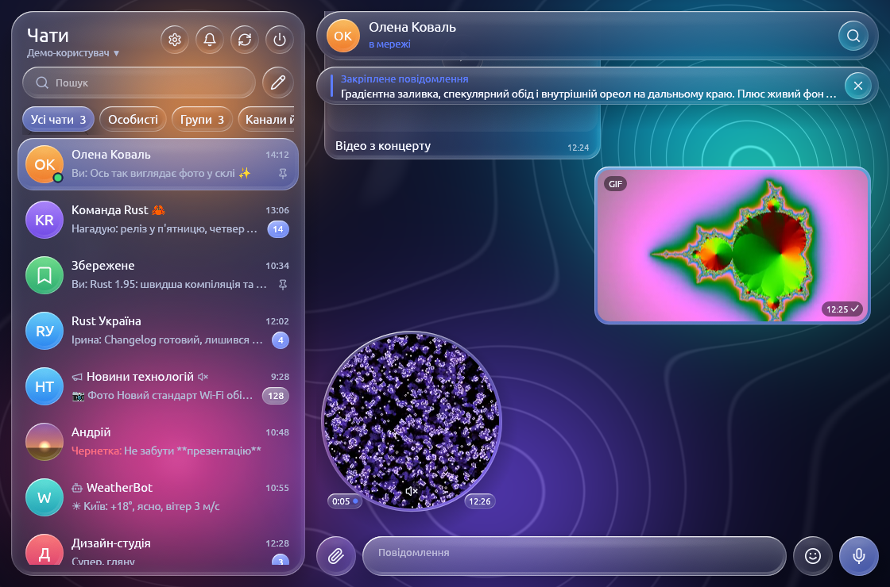
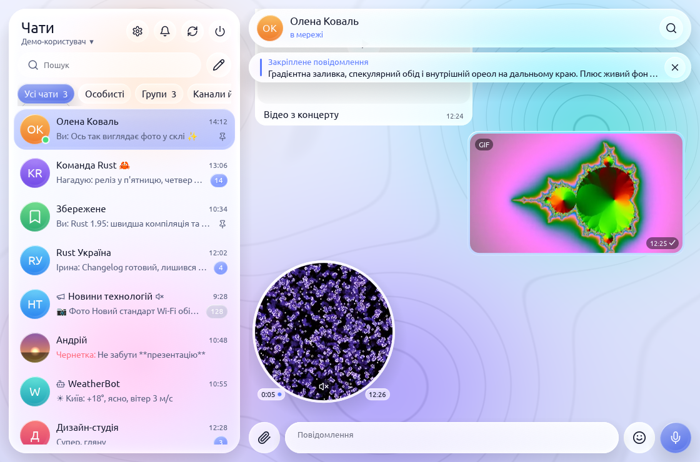

# Glassgram

[English](README.md) · **Українська**

Десктопний клієнт Telegram на Rust з інтерфейсом у стилі **Liquid Glass**.

<!-- progress -->
**Готовність за дорожньою картою: 54%** `███████████░░░░░░░░░` — 91 готово, 1 частково, 79 попереду ([ROADMAP.md](ROADMAP.md))
<!-- /progress -->

<p>
  
  
</p>

[](https://ko-fi.com/K8Z3299QVD)

- **MTProto**: [grammers](https://codeberg.org/Lonami/grammers): вхід за номером або QR-кодом, 2FA, чати, історія, відповіді, редагування й видалення, оновлення наживо
- **Медіа**: аватарки, фото, стікери з дисковим кешем (`~/.local/share/glassgram/cache`); надсилання файлів і стікерів; голосові та аудіо з хвильовою формою, перемотуванням і швидкістю; відео, GIF, кружечки й webm-стікери прямо в чаті; запис голосових (потрібен ffmpeg з `ffplay`)
- **Чати**: форуми з темами, коментарі в каналах, папки й архів, закріплення, вимкнення сповіщень, чернетки, статуси «в мережі» та «друкує…»
- **Пошук**: глобальний (поле над списком чатів) і в чаті (🔍 у шапці)
- **Форматування**: показ сутностей Telegram і розмітка під час надсилання
- **Повідомлення**: пересилання, вибір кількох, тихе й відкладене надсилання, кнопки ботів, вставка з буфера, прогрес файлів
- **Сповіщення**: системні на Linux, Windows і macOS, лічильник у заголовку вікна, іконка в треї
- **Мови**: українська й англійська вбудовані в код, німецька та будь-яка інша — з файлів локалізації (`locales/*.json`, див. нижче)
- **Акаунти**: кілька акаунтів, перемикання в меню під іменем у шапці (`src/accounts.rs`)
- **Налаштування** (⚙): мова, тема (темна, світла, як у системі), масштаб інтерфейсу, сповіщення, автовідтворення, SOCKS5-проксі, конфіденційність, активні сеанси, локальний пароль; зберігаються в `~/.local/share/glassgram/settings`
- **Розділи налаштувань** як у Telegram Desktop: Мій акаунт (ім'я, біо, юзернейм з перевіркою доступності, фото профілю) · Сповіщення · Конфіденційність і безпека · Налаштування чатів · Папки · Додатково · Пристрої · Мова
- **Черга надсилання**: текстові повідомлення, файли, голосові й кружечки з'являються одразу (годинник), повторюються без мережі й переживають перезапуск; невдалі отримують червону позначку з «Повторити» / «Видалити»
- **Скло**: справжнє розмиття через wgpu-шейдер (`src/blur.rs`, `src/glass.wgsl`); без wgpu — векторний фолбек
- **UI**: egui / eframe (wgpu), власний рендер скла — `src/glass.rs`

## Встановлення

Готові збірки — на сторінці [Releases](https://github.com/petro-pixel/glassgram/releases); у них уже є
ключі Telegram API та ffmpeg, тож лишається тільки ввійти за номером телефону:
- **Windows**: `Glassgram-<версія>-setup.exe`;
- **Linux**: `Glassgram.flatpak` — `flatpak install --user Glassgram.flatpak`, потім `flatpak run io.github.petro_pixel.Glassgram`.

### Політика підпису коду (Code signing policy)

Безкоштовний підпис коду надає [SignPath.io](https://about.signpath.io/), сертифікат — [SignPath Foundation](https://signpath.org/).
Інсталятор для Windows і `glassgram.exe` збирає й підписує GitHub Actions (`.github/workflows/release.yml`)
з цього репозиторію; вкладений `ffmpeg.exe` — збірка upstream, ми його не підписуємо.

- Автори й рецензенти: [petro-pixel](https://github.com/petro-pixel)
- Затверджують підпис: [petro-pixel](https://github.com/petro-pixel)

Приватність: програма не передає жодної інформації іншим мережевим системам, якщо цього прямо не попросив
користувач або той, хто її встановлює чи запускає. Вона з'єднується лише з серверами Telegram, щоб працював
ваш акаунт, а міні-застосунки ботів і посилання відкриває лише на вашу дію.

## Запуск із коду

```sh
cargo run --release -- --demo   # демо з вигаданими чатами, без мережі
cargo run --release             # справжній акаунт
```

На Linux для вікон міні-застосунків збірці потрібен WebKitGTK: `sudo apt install libwebkit2gtk-4.1-dev pkg-config`
(`sudo dnf install webkit2gtk4.1-devel` на Fedora, `sudo pacman -S webkit2gtk-4.1` на Arch); використовується версія з репозиторіїв дистрибутива. Windows (WebView2) і macOS (WKWebView) нічого додаткового не потребують.

Збірці з коду потрібні `api_id` та `api_hash` з <https://my.telegram.org> → *API development tools*.
Їх можна ввести у вікні входу або передати через змінні `TG_API_ID` / `TG_API_HASH`. Щоб вбудувати їх
у програму, як у релізах, задайте під час збірки `GLASSGRAM_API_ID` / `GLASSGRAM_API_HASH` (`build.rs`); з `--features no-key-screen`
зникає й екран ключів (без з'єднання застосунок пропонує «Повторити»).

Сесія та облікові дані зберігаються в теці даних: `~/.local/share/glassgram/` на Linux,
`%APPDATA%\glassgram\` на Windows, `~/Library/Application Support/glassgram/` на macOS.

Для голосових, аудіо, відео й запису потрібен ffmpeg (`ffmpeg` і `ffplay`):
- **Linux**: з дистрибутива (`sudo apt install ffmpeg`, `sudo dnf install ffmpeg`…);
- **Windows**: покладіть `ffmpeg.exe` і `ffplay.exe` поруч із `glassgram.exe` або будь-де в `PATH`;
- **macOS**: `brew install ffmpeg`.

На Linux мікрофон береться з PipeWire (`pw-record`), якщо він працює, інакше з PulseAudio;
`GLASSGRAM_AUDIO=pulse` або `GLASSGRAM_AUDIO=pipewire` вибирає примусово. На Windows закриття вікна ховає
Glassgram у трей; вийти — через меню іконки в треї.

Збірки для Windows і macOS компілюються, але на справжніх машинах ще не запускалися.

## Переклади

Українська й англійська живуть у коді. Кожна інша мова — JSON-файл, де ключ — англійський рядок:

```json
{ "@name": "Deutsch", "Cancel": "Abbrechen", "Votes: {n}": "Stimmen: {n}" }
```

1. Скопіюйте [locales/template.json](locales/template.json) (усі рядки, порожні значення) у `<код>.json`, наприклад `pl.json`.
2. Заповніть `@name` і перекладіть значення; `{заповнювачі}` лишайте як є. Порожні значення показуються англійською.
3. Покладіть файл у теку `locales` поруч із сесією та налаштуваннями (`~/.local/share/glassgram/locales/`)
   і виберіть мову в Налаштування → Мова. Перезбирати не треба.
4. Щоб мова йшла разом із програмою, додайте файл у `locales/` і в `BUILTIN` у `src/i18n.rs`.

## Структура

| Файл | Що робить |
|---|---|
| `src/backend.rs` | Потік з tokio: протокол `Cmd` / `Ev` з UI, `Worker` (з'єднання, діалоги, історія), що передає команди обробникам функцій |
| `src/backend/types.rs` | Дані для UI: чати, повідомлення, медіа, папки, конфіденційність, присутність |
| `src/backend/loader.rs`, `src/backend/convert.rs` | Фонове завантаження зображень із дисковим кешем; об'єкти Telegram → наші типи |
| `src/backend/updates.rs`, `src/backend/upload.rs` | Цикли живих оновлень і QR-входу; надсилання файлів, завантаження, кеш медіа |
| `src/backend/login.rs`, `src/backend/sessions.rs` | Вхід (код, 2FA, QR) і вихід; активні сеанси |
| `src/backend/sending.rs`, `src/backend/scheduled.rs`, `src/backend/inline.rs` | Надсилання, редагування, видалення, реакції, голоси; заплановані повідомлення; інлайн-боти й кнопки |
| `src/backend/dialogs.rs`, `src/backend/folders.rs`, `src/backend/topics.rs`, `src/backend/comments.rs` | Дії зі списком чатів, папки, теми форумів, коментарі каналів |
| `src/backend/account.rs`, `src/backend/outbox.rs` | Власний профіль, юзернейм і фото; одна спроба надсилання з черги (текст або файли, що вивантажуються у фоні) |
| `src/cache.rs` | Локальний кеш діалогів, повідомлень і черги надсилання (SQLite через `libsql`) |
| `src/blur.rs`, `src/glass.wgsl` | GPU-розмиття: фон у текстуру → гаус → скляні панелі із заломленням |
| `src/glass.rs` | Живий фон, скляні панелі (градієнт, спекулярний обід, ореол заломлення, тінь), кнопки, поля, аватарки |
| `src/app.rs` | `App`: стан, події (`push_event`), дії користувача (`apply`), цикл кадру |
| `src/app/history.rs`, `src/app/bubbles.rs` | Відкритий чат: історія, шапка, оверлеї; малювання бульбашок, альбомів, медіакарток, реакцій |
| `src/app/composer.rs`, `src/app/recording.rs` | Поле повідомлення: текст, файли, стікери, емодзі, інлайн-боти; запис голосових і кружечків |
| `src/app/media.rs`, `src/app/dialogs.rs` | Аудіоплеєр, відеокліпи, переглядач фото; вікна експорту, пересилання, планування |
| `src/app/login.rs`, `src/app/accounts_ui.rs` | Екрани входу й блокування паролем; меню акаунтів та інші акаунти у фоні |
| `src/app/forum.rs`, `src/app/comments.rs`, `src/app/folders.rs` | Теми форумів, коментарі каналів, редактор папок із кольором тегу, теги папок у рядках чатів, рекомендовані папки |
| `src/app/chatview.rs`, `src/backend/chatview.rs` | Доповнення чату: панель і список закріплених, кнопки переходу (вниз / згадки / реакції), «Переглянули», лічильники переглядів, захищений вміст |
| `src/app/chatedit.rs`, `src/backend/chatedit.rs` | «Редагувати групу / канал»: фото, назва, опис, дозволи учасників, повільний режим |
| `src/app/birthdays.rs`, `src/backend/birthdays.rs` | Дні народження: нагадування над списком чатів, дата в інформації про користувача і в «Мій акаунт» |
| `src/app/botstart.rs`, `src/backend/botstart.rs` | Діплінки ботів `t.me/<bot>?start=…`: смуга «Почати» з параметром |
| `src/app/similar.rs`, `src/backend/similar.rs` | Вкладка «Схожі канали» в інформації про канал |
| `src/app/saved.rs`, `src/backend/saved.rs` | «Збережене» за джерелами: «Усі» і вкладка на кожен чат; теги-реакції як фільтри, їх перейменування |
| `src/app/chatsearch.rs` | Панель пошуку в чаті: фільтри за типом і відправником, результати |
| `src/app/stories.rs`, `src/backend/stories.rs` | Історії: стрічка над списком чатів і переглядач (відео зі звуком, відповіді, реакції) |
| `src/app/confirm.rs` | «Відкрити посилання?» для прихованих посилань і «Запустити файл?» для отриманих програм |
| `src/app/gifts.rs`, `src/backend/gifts.rs` | Вкладка «Подарунки» в профілі |
| `src/app/textures.rs` | Зображення на GPU з лімітом пам'яті; вивантажені повертаються з дискового кешу |
| `src/app/emojikw.rs`, `src/backend/emojikw.rs` | Підказки емодзі під час набору `:слово` |
| `src/app/report.rs`, `src/backend/report.rs` | Вікно «Поскаржитися» для повідомлень |
| `src/app/quote.rs`, `src/backend/reply.rs` | Відповіді з цитатою та в іншому чаті |
| `src/app/newchat.rs`, `src/backend/newchat.rs` | «Новий чат»: контакти, нова група, новий канал із типом, посиланням і підписниками |
| `src/app/privacy.rs`, `src/backend/privacy.rs` | Винятки правил приватності (завжди / ніколи не дозволяти) і глобальні перемикачі: нові чати не з контактів, час прочитання, хто може писати |
| `src/app/password.rs`, `src/backend/password.rs` | Двоетапна перевірка: увімкнути й вимкнути хмарний пароль, змінити його, підказку й пошту для відновлення (SRP, код із пошти) |
| `src/app/polls.rs`, `src/backend/polls.rs` | Вікно «Нове опитування»: опитування й вікторини |
| `src/app/editmedia.rs`, `src/backend/editmedia.rs` | Редагування повідомлень із медіа: підпис, заміна фото чи файлу |
| `src/app/sendbox.rs`, `src/app/spoiler.rs` | Вікно «Надіслати файли» (прев'ю, підпис, стиснення, спойлер, підпис над медіа); спойлер поверх прихованих медіа |
| `src/app/webapp.rs`, `src/backend/webapp.rs`, `src/webview.rs` | Міні-застосунки: запити до сервера, процес вікна WebView (`glassgram --webview`) і його міст |
| `src/app/contacts.rs`, `src/backend/contacts.rs` | Вікно «Новий контакт», додавання / видалення контакту й блокування з інформації про користувача, список заблокованих у «Конфіденційності» |
| `src/app/translate.rs`, `src/backend/translate.rs` | Вікно «Перекласти» з меню повідомлення |
| `src/app/calendar.rs` | Календар «Перейти до дати» над чатом (запит — `Cmd::JumpToDate` у `src/backend/chatview.rs`) |
| `src/app/notify.rs`, `src/backend/notify.rs` | Сповіщення для чатів: типові налаштування для особистих чатів, груп і каналів, винятки, стан чату за його категорією |
| `src/app/sponsored.rs`, `src/backend/sponsored.rs` | Спонсоровані повідомлення в історії каналу (після останнього допису й між дописами, медіареклама): бульбашка «Реклама», звіти про перегляд і натискання, «Про цю рекламу», скарга, приховування для Premium |
| `src/app/suggest.rs`, `src/backend/suggest.rs` | Прев'ю посилань (у бульбашках і над полем вводу), підказки @згадок і команд ботів, «Почати» для ботів |
| `src/app/info.rs`, `src/backend/info.rs` | Колонка інформації про чат: профіль, учасники, спільні медіа, сповіщення чату, вийти / очистити / видалити |
| `src/app/settings_pages.rs` | Сторінки налаштувань (як у Telegram Desktop), редактор «Мого акаунта» |
| `src/app/hotkeys.rs` | Гарячі клавіші |
| `src/app/outbox.rs` | Черга надсилання: бульбашки в очікуванні й невдалі, повтори з паузою |
| `src/app/chatlist.rs` | Колонка й вкладки папок, перетягування закріплених чатів і папок |
| `src/player.rs` | Програвач голосових і аудіо через `ffplay`: пауза, перемотування, швидкість |
| `src/video.rs` | Кадри відео через `ffmpeg` у текстуру egui: GIF, кружечки, відео, webm-стікери; `.tgs`-стікери з `src/lottie.rs` |
| `src/lottie.rs` | Анімовані (Lottie) стікери, що малюються на процесорі: `velato` + `vello_cpu`, з обмеженнями для чужих файлів |
| `src/camera.rs` | Запис відеоповідомлень: камера + мікрофон → MP4, кругле прев'ю; мікрофон для всіх записів (`Mic`) |
| `src/recorder.rs` | Запис голосових через `ffmpeg`, рівень і хвильова форма |
| `src/export.rs` | Експорт історії чату в HTML і JSON |
| `src/platform.rs` | Усе, що відрізняється між Linux, Windows і macOS: теки, ffmpeg/ffplay, сповіщення; безпечне відкриття посилань (`open_url`) і отриманих файлів (`open_file`, `safe_file_name`), приватні тимчасові файли |
| `src/settings.rs` | Налаштування та їх збереження |
| `src/lock.rs` | Локальний пароль (сіль + SHA-256) |
| `src/tray.rs`, `src/logo.rs` | Іконка в треї (`ksni` на Linux, `tray-icon` на Windows і macOS) та логотип програми |
| `src/icons.rs`, `assets/icons/` | Векторні іконки: SVG-файли Lucide (24×24), читаються через `roxmltree` і згладжуються через `kurbo` |
| `src/i18n.rs`, `locales/` | Мова інтерфейсу: `l!`/`lf!` для української й англійської, JSON-файли локалізації для решти |
| `src/format.rs` | Сутності Telegram ↔ розмітка, текст із форматуванням для egui, шрифти |
| `src/demo.rs` | Демо-дані |
| `build.rs` | Ключі Telegram API із середовища збірки (замасковані), іконка exe на Windows |
| `packaging/`, `.github/workflows/release.yml` | Інсталятор Windows (Inno Setup), маніфест Flatpak, `.desktop`, metainfo, іконки; релізні збірки |

## Керування

- Права кнопка миші на повідомленні відкриває меню: відповісти, копіювати, редагувати, видалити.
- Подвійний клік — відповісти. Клік по смужці відповіді над полем — процитувати частину повідомлення або відповісти в іншому чаті.
- Esc скасовує відповідь або редагування й закриває панель стікерів.
- 📎 — надіслати файли (або перетягніть чи вставте їх): вікно покаже, що піде, з підписом (текст із поля вводу), «Стиснути зображення», «Приховати під спойлер» і «Підпис над медіа»; файли, кинуті на нього, додаються. Правий клік по 📎: надіслати без стиснення, створити опитування чи вікторину. Фото чи відео під спойлером відкривається кліком. Редагуючи фото чи файл («Редагувати» в його меню): ⟳ у смузі «Редагування» замінює його (правий клік — без стиснення), або перетягніть файл у чат.
- 🙂 — панель стікерів. Емодзі, набране саме, пропонує відповідні стікери над полем.
- Клік по фото чи файлу — завантажити в «Завантаження» і відкрити.
- Права кнопка миші на чаті: закріпити, вимкнути сповіщення, позначити прочитаним, архівувати.
- Клік по назві чату в шапці відкриває інформацію про чат (Esc закриває): біо чи опис, посилання, сповіщення, учасники (клік відкриває особистий чат), вкладки спільних медіа, вийти / очистити історію / видалити чат.
- Розмітка в полі вводу: `**жирний**`, `__курсив__`, `~~закреслений~~`, `||спойлер||`, `` `код` ``, ```` ```блок``` ````, `[текст](https://…)`.
- Клік по хештегу шукає його в чаті, по команді бота — надсилає її.
- `@` у групі та `/` на початку поля відкривають підказки (учасники, команди ботів): ↑/↓ — вибір, Enter чи клік — вставити (команду — надіслати), Tab — вставити, Esc — закрити. Кнопка «/» біля поля в чаті з ботом відкриває меню команд. `:слово` (від двох літер, напр. `:серце`, `:heart`) так само підказує емодзі.
- Над полем вводу з'являється прев'ю посилання; ✕ надсилає повідомлення без прев'ю.
- Права кнопка на «Надіслати»: без звуку або запланувати.
- «Вибрати» в меню повідомлення вмикає режим вибору; Esc виходить із нього.
- Enter надсилає, Shift+Enter — новий рядок.
- Перехід до дати: кнопка календаря в пошуку по чату або клік по даті між повідомленнями.
- Enter надсилає, Shift+Enter переносить рядок; у Налаштування → Налаштування чатів можна перемкнути надсилання на Ctrl+Enter (Cmd+Enter на macOS) і змінити розмір тексту повідомлень та щільність списку чатів (щільний, звичайний, просторий).
- Гарячі клавіші (як у Telegram Desktop): Ctrl+F — пошук у чаті (або в списку чатів), Ctrl+K — пошук у списку чатів, Ctrl+1…9 — папки, Alt+↑/↓ або Ctrl+Tab / Ctrl+Shift+Tab — попередній/наступний чат, Ctrl+E або ↑ у порожньому полі — редагувати своє останнє повідомлення, Esc — закрити верхню панель, потім чат.
- У `--demo` повідомлення з `#offline` імітує відсутність мережі (годинник → повтори → червона позначка).
- Папки: «+» праворуч від вкладок (або внизу колонки) — нова; права кнопка на папці — редагувати чи видалити; перетягування змінює порядок. Вкладки зверху чи колонка зліва — у налаштуваннях.
- Закріплені чати перетягуються мишею, щоб змінити їхній порядок (і в папках, і в архіві).
- ✎ біля пошуку — «Нова група», «Новий канал», «Контакти».
- Ctrl+V із картинкою чи скопійованими файлами надсилає їх.
- ▶ на голосовому чи аудіо грає його; клік по хвилі перемотує, чип «1×» змінює швидкість. Клік по відео грає його в бульбашці; «Відкрити в програвачі» — у меню.
- 🎤 (кнопка «Надіслати» при порожньому полі) починає запис голосового; ➤ надсилає, ■ зупиняє для прослуховування, Esc скасовує.
- Права кнопка на мікрофоні — записати відеоповідомлення (камера — у налаштуваннях або `GLASSGRAM_CAMERA`).

## Що вже є і що далі

Повна дорожня карта з пріоритетами й оцінкою часу — у [ROADMAP.md](ROADMAP.md) (англійською).
Правила для агентів і дизайн-код — у [AGENTS.md](AGENTS.md) (англійською).

## Ліцензія

GPL-3.0-or-later, як і в Telegram Desktop. Див. [LICENSE](LICENSE).
Шрифт Ubuntu — під Ubuntu Font Licence, див. [assets/fonts/UFL.txt](assets/fonts/UFL.txt).
Іконки — з [Lucide](https://lucide.dev) під ліцензією ISC, див. [assets/icons/LUCIDE-LICENSE.txt](assets/icons/LUCIDE-LICENSE.txt).
Glassgram — неофіційний клієнт і не пов'язаний з Telegram FZ-LLC.
